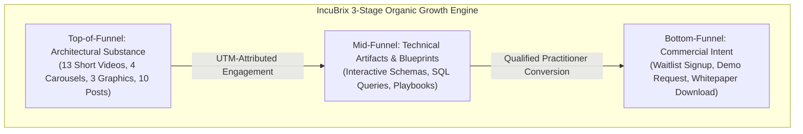
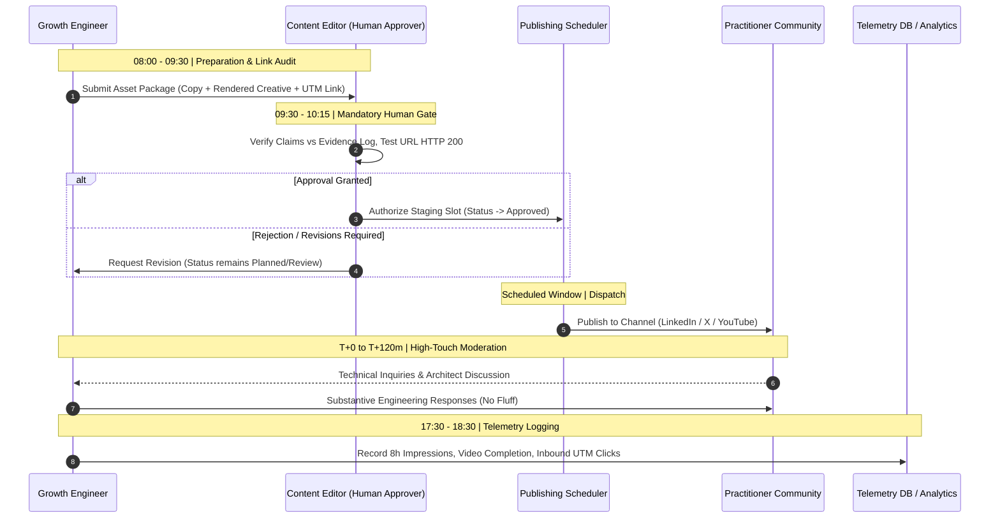
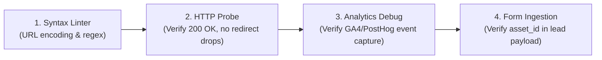
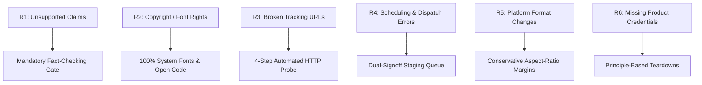

# IncuBrix 30-Day Launch Kit & Operational Campaign Playbook

**Assessment Stream:** Associate Tech Partner — Growth Engineer (Option 2: Social Media Marketing & Content Engine)
**Target Organization:** IncuBrix
**Repository Workspace:** `D:\Projects\Incubrix-Growth`
**GitHub Repository:** [https://github.com/Janani-TG/Incubrix-Growth](https://github.com/Janani-TG/Incubrix-Growth)
**Document Status:** Operational Campaign Specification — Aligned with Assessment PDF & Asset Blueprint
**Campaign Execution Window:** Planned 30-Day Operational Cycle (Days 01–30)
**Readiness Guardrail:** All 30 asset records remain categorized as `Planned` pending live domain confirmation and credentialed publishing approval.

---

## 1. Campaign Objective and Target Audience

### 1.1 Executive Objective & Strategic Positioning
The primary objective of this 30-day organic campaign is to establish **IncuBrix** as the definitive thought leader in **evidence-based growth engineering, user onboarding telemetry, and data integrity** for B2B SaaS organizations.

Rather than relying on unverified claims, speculative AI promises, or superficial marketing platitudes, this campaign demonstrates growth as an engineering discipline. Every piece of collateral is grounded in verifiable architectural principles, schema designs, telemetry pipelines, and empirical SaaS retention realities.

#### Strategic Alignment with Content Strategy:
- **Core Positioning:** IncuBrix is the growth engineering engine that bridges the gap between software development and pipeline attribution.
- **Content Pillars (P1–P5):**
  - **P1: Growth Engineering Architecture & Systems** (9 Assets)
  - **P2: Evidence-Based Onboarding & Retention Tactics** (7 Assets)
  - **P3: Creator & Marketer Workflow Engineering** (5 Assets)
  - **P4: Attribution, UTMs & Data Integrity** (5 Assets)
  - **P5: Technical Case Teardowns & Industry Lessons** (4 Assets)
- **Ethos:** 100% brand-safe, anti-hype, evidence-backed, and developer-respectful.



---

### 1.2 Target Audience Segments, Pain Points, and Intended Actions

The campaign addresses three core practitioner and buyer personas in high-growth B2B SaaS:

#### Segment 1: Early-to-Growth-Stage Technical Founders (Seed to Series A)
- **Profile:** Technical CEOs, CTOs, and technical co-founders of B2B SaaS products (5–50 employees).
- **Primary Pain Points:**
  - High customer acquisition cost (CAC) paired with severe drop-offs in self-serve onboarding.
  - Scaling paid marketing spend before establishing cohort retention stabilization (the "leaky bucket" trap).
  - Lack of in-house growth telemetry infrastructure to diagnose why signups churn within the first 72 hours.
- **Content Resonance:** Cohort retention economics, pre-scale engineering readiness checklists, retention curves vs churn traps, high-level architecture overviews.
- **Intended Conversion Action:** Save strategic carousels, download the Pre-Scale Engineering Checklist, request an architectural telemetry consultation or demo waitlist.

#### Segment 2: Growth Engineers & Product Technical Leads
- **Profile:** Full-stack developers instrumenting telemetry, growth engineers, backend leads, and technical product managers.
- **Primary Pain Points:**
  - Brittle client-side event tracking scripts that break on frontend refactors or ad-blockers.
  - Noisy data lakes filled with hundreds of arbitrary, unvalidated client clicks.
  - Disconnect between marketing webhook dispatches and core database state (fire-and-forget traps, non-idempotent ingestion).
- **Content Resonance:** Server-side event schemas, idempotent webhook pipelines, SQL cohort queries, client vs server ingestion teardowns, code snippets.
- **Intended Conversion Action:** Star/clone open-source schema examples, copy SQL query templates, download unified event taxonomy specifications.

#### Segment 3: Technical Marketers & DevRel Leads
- **Profile:** Developer advocates, technical content leads, and B2B marketing technologists operating in developer-focused ecosystems.
- **Primary Pain Points:**
  - Translating dense technical documentation (release notes, architecture whitepapers) into engaging multi-channel assets without dumbing down the content.
  - Audience skepticism on developer platforms (Reddit, Hacker News, X) toward promotional marketing fluff.
  - Inconsistent UTM parameter tagging leading to fragmented attribution dashboards.
- **Content Resonance:** Multi-format repurposing playbooks, transparent community discourse rules, structured 23-column calendar metadata, automated UTM hygiene scripts.
- **Intended Conversion Action:** Download the content repurposing matrix, adopt standardized UTM taxonomy conventions, engage in community technical discourse.

---

## 2. 30-Day Publishing Calendar

The following master schedule maps all **30 existing assets** from [`research/asset_blueprint.csv`](research/asset_blueprint.csv) across the 30-day sprint. Every asset ID appears exactly once.

### 2.1 Multi-Channel Distribution Matrix
- **LinkedIn (11 Assets):** 4 Multi-Page Carousels, 4 Long-Form Technical Posts, 3 Short Videos. Focus: In-depth engineering frameworks, executive briefings, and slide decks.
- **X / Twitter (10 Assets):** 6 Formatted Threads/Posts, 3 Architectural Graphics, 1 Short Video. Focus: Real-time developer debate, system diagrams, and case teardowns.
- **YouTube Shorts (9 Assets):** 9 Vertical Short Videos ($\le 60$s). Focus: Dynamic code breakdowns, schema tutorials, and visual teardowns.

### 2.2 Master 30-Day Publishing Table

| Day | Asset ID | Platform | Format | Content Pillar | Working Title / Topic | Primary Call to Action (CTA) | Tracking Link Status | Status |
| :---: | :--- | :--- | :--- | :--- | :--- | :--- | :--- | :---: |
| **Day 01** | `ast_bp_01_li_caro` | LinkedIn | `carousel` | Growth Engineering Architecture & Systems | The 5-Slide Growth Telemetry Architecture | Save this carousel and download the full telemetry architecture blueprint via link. | `Pending Confirmation [https://incubrix.com/blueprint?utm_source=linkedin&utm_medium=carousel&utm_campaign=telemetry_2027&utm_content=ast_bp_01_li_caro]` | `Planned` |
| **Day 02** | `ast_bp_02_x_post` | X | `text_post` | Evidence-Based Onboarding & Retention Tactics | The 72-Hour SaaS Retention Rule | Bookmark this post and check your onboarding drop-off in your event logs today. | `Pending Confirmation [https://incubrix.com/retention-guide?utm_source=x&utm_medium=text_post&utm_campaign=retention_72h&utm_content=ast_bp_02_x_post]` | `Planned` |
| **Day 03** | `ast_bp_03_yt_vid` | YouTube Shorts | `short_video` | Growth Engineering Architecture & Systems | Why Most Product Analytics Break Under Scale | Subscribe for weekly growth engineering breakdowns. Full architecture link in description. | `Pending Confirmation [https://incubrix.com/event-schemas?utm_source=youtube_shorts&utm_medium=short_video&utm_campaign=schema_tips&utm_content=ast_bp_03_yt_vid]` | `Planned` |
| **Day 04** | `ast_bp_04_li_text` | LinkedIn | `text_post` | Attribution, UTMs & Data Integrity | Why Growth Engineers Reject Vanity Metric Dashboards | What core metric does your engineering team inspect every Monday? Share in comments. | `Pending Confirmation [https://incubrix.com/cockpit-metrics?utm_source=linkedin&utm_medium=text_post&utm_campaign=data_integrity&utm_content=ast_bp_04_li_text]` | `Planned` |
| **Day 05** | `ast_bp_05_x_graph` | X | `graphic` | Growth Engineering Architecture & Systems | System Diagram: Webhook to Attribution Pipeline | Check out the full pipeline spec and architecture breakdown in our guide. | `Pending Confirmation [https://incubrix.com/pipeline-spec?utm_source=x&utm_medium=graphic&utm_campaign=system_diagrams&utm_content=ast_bp_05_x_graph]` | `Planned` |
| **Day 06** | `ast_bp_06_yt_vid` | YouTube Shorts | `short_video` | Attribution, UTMs & Data Integrity | The 3 UTM Mistakes Costing You Attribution | Grab our open-source UTM builder tool via link in description. | `Pending Confirmation [https://incubrix.com/utm-builder?utm_source=youtube_shorts&utm_medium=short_video&utm_campaign=utm_tips&utm_content=ast_bp_06_yt_vid]` | `Planned` |
| **Day 07** | `ast_bp_07_li_vid` | LinkedIn | `short_video` | Evidence-Based Onboarding & Retention Tactics | Executive Briefing: Instrumenting Time-to-Value | Read our complete engineering framework on onboarding latency reduction. | `Pending Confirmation [https://incubrix.com/ttv-framework?utm_source=linkedin&utm_medium=short_video&utm_campaign=exec_briefings&utm_content=ast_bp_07_li_vid]` | `Planned` |
| **Day 08** | `ast_bp_08_x_post` | X | `text_post` | Technical Case Teardowns & Industry Lessons | Indie SaaS Funnel Teardown: Friction Points | Read our full teardown of 5 common onboarding UX friction patterns. | `Pending Confirmation [https://incubrix.com/onboarding-teardowns?utm_source=x&utm_medium=text_post&utm_campaign=teardowns&utm_content=ast_bp_08_x_post]` | `Planned` |
| **Day 09** | `ast_bp_09_yt_vid` | YouTube Shorts | `short_video` | Growth Engineering Architecture & Systems | Building an Event Stream Schema from Scratch | Download the JSON schema template from the link in description. | `Pending Confirmation [https://incubrix.com/schemas?utm_source=youtube_shorts&utm_medium=short_video&utm_campaign=schema_json&utm_content=ast_bp_09_yt_vid]` | `Planned` |
| **Day 10** | `ast_bp_10_li_caro` | LinkedIn | `carousel` | Creator & Marketer Workflow Engineering | Whitepaper to 12 Social Assets: The Repurposing Matrix | Save this carousel and access our open-source repurposing matrix template. | `Pending Confirmation [https://incubrix.com/matrix-template?utm_source=linkedin&utm_medium=carousel&utm_campaign=content_matrix&utm_content=ast_bp_10_li_caro]` | `Planned` |
| **Day 11** | `ast_bp_11_x_graph` | X | `graphic` | Evidence-Based Onboarding & Retention Tactics | Visual Guide: Cohort Retention Curves vs Churn Traps | Bookmark this chart and inspect your product's Day-30 retention plateau today. | `Pending Confirmation [https://incubrix.com/cohort-analysis?utm_source=x&utm_medium=graphic&utm_campaign=retention_curves&utm_content=ast_bp_11_x_graph]` | `Planned` |
| **Day 12** | `ast_bp_12_yt_vid` | YouTube Shorts | `short_video` | Creator & Marketer Workflow Engineering | How Content Fingerprinting Stops Feed Duplication | Check out the open source Python implementation in our documentation. | `Pending Confirmation [https://incubrix.com/fingerprint-guide?utm_source=youtube_shorts&utm_medium=short_video&utm_campaign=fingerprinting&utm_content=ast_bp_12_yt_vid]` | `Planned` |
| **Day 13** | `ast_bp_13_li_text` | LinkedIn | `text_post` | Evidence-Based Onboarding & Retention Tactics | The Technical Founder's Checklist Before Scaling Paid Ads | Download our comprehensive pre-scale engineering readiness checklist via link. | `Pending Confirmation [https://incubrix.com/pre-scale-checklist?utm_source=linkedin&utm_medium=text_post&utm_campaign=readiness_checklist&utm_content=ast_bp_13_li_text]` | `Planned` |
| **Day 14** | `ast_bp_14_x_post` | X | `text_post` | Growth Engineering Architecture & Systems | Code Architecture: Why Idempotent Event Ingestion Matters | Read our technical guide on building idempotent telemetry endpoints. | `Pending Confirmation [https://incubrix.com/idempotency?utm_source=x&utm_medium=text_post&utm_campaign=tech_deepdive&utm_content=ast_bp_14_x_post]` | `Planned` |
| **Day 15** | `ast_bp_15_yt_vid` | YouTube Shorts | `short_video` | Evidence-Based Onboarding & Retention Tactics | Demystifying First-72-Hour Activation Telemetry | Copy the SQL query from the link in description and run it on your staging DB. | `Pending Confirmation [https://incubrix.com/sql-queries?utm_source=youtube_shorts&utm_medium=short_video&utm_campaign=sql_activation&utm_content=ast_bp_15_yt_vid]` | `Planned` |
| **Day 16** | `ast_bp_16_li_vid` | LinkedIn | `short_video` | Growth Engineering Architecture & Systems | Why Engineering and Marketing Must Share One Event Schema | Download the unified event taxonomy cheat sheet via the link. | `Pending Confirmation [https://incubrix.com/event-taxonomy?utm_source=linkedin&utm_medium=short_video&utm_campaign=exec_taxonomy&utm_content=ast_bp_16_li_vid]` | `Planned` |
| **Day 17** | `ast_bp_17_x_graph` | X | `graphic` | Growth Engineering Architecture & Systems | Architecture Teardown: Client-Side vs Server-Side Event Tracking | Check our complete comparison guide on client vs server telemetry. | `Pending Confirmation [https://incubrix.com/tracking-architecture?utm_source=x&utm_medium=graphic&utm_campaign=client_vs_server&utm_content=ast_bp_17_x_graph]` | `Planned` |
| **Day 18** | `ast_bp_18_yt_vid` | YouTube Shorts | `short_video` | Attribution, UTMs & Data Integrity | Quick Fix: Clean UTM Parameters in 30 Seconds | Download the Python UTM script from the link in description. | `Pending Confirmation [https://incubrix.com/python-utm-script?utm_source=youtube_shorts&utm_medium=short_video&utm_campaign=utm_automation&utm_content=ast_bp_18_yt_vid]` | `Planned` |
| **Day 19** | `ast_bp_19_li_caro` | LinkedIn | `carousel` | Attribution, UTMs & Data Integrity | The Growth Engineer's Data Hygiene Guide | Save this carousel for your quarterly telemetry maintenance sprint. | `Pending Confirmation [https://incubrix.com/data-hygiene-guide?utm_source=linkedin&utm_medium=carousel&utm_campaign=hygiene_guide&utm_content=ast_bp_19_li_caro]` | `Planned` |
| **Day 20** | `ast_bp_20_x_post` | X | `text_post` | Technical Case Teardowns & Industry Lessons | Anti-Pattern: The 'Fire-and-Forget' Webhook Trap | Read our technical post-mortem and sample retry implementation via link. | `Pending Confirmation [https://incubrix.com/webhook-retries?utm_source=x&utm_medium=text_post&utm_campaign=webhook_patterns&utm_content=ast_bp_20_x_post]` | `Planned` |
| **Day 21** | `ast_bp_21_yt_vid` | YouTube Shorts | `short_video` | Creator & Marketer Workflow Engineering | End-to-End Walkthrough: Transforming Release Notes into Social Posts | Subscribe and explore our content engine automation scripts in GitHub. | `Pending Confirmation [https://incubrix.com/workflow-automation?utm_source=youtube_shorts&utm_medium=short_video&utm_campaign=workflow_demo&utm_content=ast_bp_21_yt_vid]` | `Planned` |
| **Day 22** | `ast_bp_22_li_text` | LinkedIn | `text_post` | Evidence-Based Onboarding & Retention Tactics | The Economics of Retention vs Acquisition for Early-Stage B2B | Check our interactive cohort retention financial model spreadsheet. | `Pending Confirmation [https://incubrix.com/retention-economics?utm_source=linkedin&utm_medium=text_post&utm_campaign=saas_economics&utm_content=ast_bp_22_li_text]` | `Planned` |
| **Day 23** | `ast_bp_23_x_post` | X | `text_post` | Creator & Marketer Workflow Engineering | Developer Community Engagement: Discourse vs Broadcast | Read our guide to ethical, transparent developer community engagement. | `Pending Confirmation [https://incubrix.com/dev-marketing-guide?utm_source=x&utm_medium=text_post&utm_campaign=devrel_rules&utm_content=ast_bp_23_x_post]` | `Planned` |
| **Day 24** | `ast_bp_24_yt_vid` | YouTube Shorts | `short_video` | Growth Engineering Architecture & Systems | Inside a Growth Pipeline: Database Triggers & Webhook Verification | Subscribe and download the background worker code pattern in our docs. | `Pending Confirmation [https://incubrix.com/background-workers?utm_source=youtube_shorts&utm_medium=short_video&utm_campaign=fastapi_workers&utm_content=ast_bp_24_yt_vid]` | `Planned` |
| **Day 25** | `ast_bp_25_li_vid` | LinkedIn | `short_video` | Attribution, UTMs & Data Integrity | How to Measure Content ROI Without Guesswork | Watch the video and download the social-to-revenue attribution framework. | `Pending Confirmation [https://incubrix.com/attribution-framework?utm_source=linkedin&utm_medium=short_video&utm_campaign=exec_attribution&utm_content=ast_bp_25_li_vid]` | `Planned` |
| **Day 26** | `ast_bp_26_x_post` | X | `text_post` | Technical Case Teardowns & Industry Lessons | Technical Case Teardown: How Self-Serve Onboarding Leaks 40% of Users | Check our complete breakdown of 10 onboarding friction anti-patterns. | `Pending Confirmation [https://incubrix.com/funnel-friction?utm_source=x&utm_medium=text_post&utm_campaign=friction_teardown&utm_content=ast_bp_26_x_post]` | `Planned` |
| **Day 27** | `ast_bp_27_yt_vid` | YouTube Shorts | `short_video` | Creator & Marketer Workflow Engineering | Step-by-Step: Setting Up Structured Social Campaign Metadata | Download our official 23-column content calendar template via link in description. | `Pending Confirmation [https://incubrix.com/calendar-template?utm_source=youtube_shorts&utm_medium=short_video&utm_campaign=calendar_structure&utm_content=ast_bp_27_yt_vid]` | `Planned` |
| **Day 28** | `ast_bp_28_li_caro` | LinkedIn | `carousel` | Growth Engineering Architecture & Systems | The 2027 Growth Engineering Playbook | Save this carousel and download the 2027 Growth Engineering Playbook PDF. | `Pending Confirmation [https://incubrix.com/playbook-2027?utm_source=linkedin&utm_medium=carousel&utm_campaign=playbook_2027&utm_content=ast_bp_28_li_caro]` | `Planned` |
| **Day 29** | `ast_bp_29_x_vid` | X | `short_video` | Evidence-Based Onboarding & Retention Tactics | Fast Teardown: 3 Retention Leaks in 45 Seconds | Repost this and check your telemetry event timestamps. | `Pending Confirmation [https://incubrix.com/retention-bugs?utm_source=x&utm_medium=short_video&utm_campaign=quick_teardowns&utm_content=ast_bp_29_x_vid]` | `Planned` |
| **Day 30** | `ast_bp_30_li_text` | LinkedIn | `text_post` | Technical Case Teardowns & Industry Lessons | The Growth Engineering Retrospective: Lessons from 30 Days of Telemetry | Read the complete 30-day sprint retrospective and methodology documentation. | `Pending Confirmation [https://incubrix.com/sprint-retrospective?utm_source=linkedin&utm_medium=text_post&utm_campaign=sprint_retro&utm_content=ast_bp_30_li_text]` | `Planned` |

---

## 3. Daily Operating Workflow

A disciplined daily operating procedure is enforced across all 30 publishing days. This guarantees consistent brand safety, strict human authorization, active practitioner engagement, and rapid attribution telemetry.



### 3.1 Daily Workflow Stages & Time Allocations

| Stage | Window (Local Time) | Duration | Responsible Role | Key Actions & Protocols | Explicit Human Gate |
| :--- | :---: | :---: | :--- | :--- | :---: |
| **1. Morning Preparation & Verification** | 08:00 – 09:30 | 90 min | Growth Engineer | - Pull scheduled asset files from `outputs/final/` and `outputs/source/`.<br>- Confirm video duration $\le 60$s, PDF page count, or PNG dimensions.<br>- Run pre-flight link check (HTTP 200 check, UTM syntax inspection). | No |
| **2. Editorial Sign-Off & Approval Gate** | 09:30 – 10:15 | 45 min | Content Editor / Legal Reviewer | - **Mandatory Check:** Verify copy against authorized evidence log.<br>- Ensure zero unsupported product claims or fake metrics.<br>- Confirm rights clearance for fonts, audio, and visual assets.<br>- **Formally authorize publishing slot.** | **YES (Strict Human Approval Required)** |
| **3. Dispatch & Multi-Channel Publishing** | *Platform Window* | 30 min | Content Operations Lead | - **LinkedIn:** 08:30 – 10:00 (Tuesday / Thursday / Friday optimal).<br>- **X:** 11:30 – 13:30 (Monday through Saturday mid-day).<br>- **YouTube Shorts:** 15:00 – 17:00 (afternoon mobile dwell window).<br>- Manual upload or authorized scheduler release. | Yes (Final release trigger) |
| **4. Community Engagement & Dialogue** | T+0 to T+120 min | 60–90 min | Growth Engineer / DevRel | - Monitor post replies within the critical 2-hour algorithmic window.<br>- Respond to developer queries with architectural context.<br>- Participate in peer comment threads without sales pressure. | No |
| **5. Evening Telemetry & Incident Logging** | 17:30 – 18:30 | 60 min | Growth Engineer | - Record Day-0 metrics: impressions, video completions, link clicks.<br>- Verify UTM parameter capture in Google Analytics / PostHog.<br>- Log broken links or anomalous drop-offs in the risk register. | No |

### 3.2 RACI Operational Matrix

| Task / Deliverable | Growth Engineer (Candidate) | Content Editor / Peer Reviewer | Creative / Design Lead | Executive Sponsor (IncuBrix) |
| :--- | :---: | :---: | :---: | :---: |
| **Asset Scripting & Copywriting** | **Accountable / Responsible** | Consulted | Informed | Informed |
| **Video Rendering & Compilation** | **Responsible** | Informed | Consulted | Informed |
| **Carousel & Graphic Rendering** | **Responsible** | Informed | Consulted | Informed |
| **Evidence & Claim Verification** | Responsible | **Accountable** | Informed | Informed |
| **Final Publishing Authorization** | Consulted | **Accountable** | Informed | **Consulted / Informed** |
| **Community Comment Moderation** | **Responsible** | Consulted | Informed | Informed |
| **Attribution & KPI Logging** | **Accountable / Responsible** | Informed | Informed | Informed |

---

## 4. Measurement Framework

> [!IMPORTANT]
> **Strict Factuality Notice:**
> In compliance with assessment instructions, **no baseline audience statistics, historic engagement rates, or campaign conversion numbers have been fabricated**. The targets below are **proposed operational benchmarks** derived from verified B2B developer-marketing standards. Actual performance figures will be populated only as live telemetry is recorded.

### 4.1 Funnel KPI Hierarchy, Formulas, and Telemetry Data Sources

| Funnel Stage | Key Performance Indicator (KPI) | Calculation Formula | Telemetry Data Source | Proposed Target Benchmark | Actual Measured Result |
| :--- | :--- | :--- | :--- | :---: | :---: |
| **Top of Funnel** | **Organic Impressions** | $\sum \text{Views on feed / stream}$ | LinkedIn Analytics, X Analytics, YouTube Studio | $\ge 2,500$ / asset | *[Pending Live Dispatch]* |
| | **Unique Account Reach** | $\text{Distinct user accounts exposed to post}$ | Native Platform Insights | $\ge 1,800$ / asset | *[Pending Live Dispatch]* |
| | **Video Completion Rate** | $\left(\frac{\text{Completed Views}}{\text{Total Video Starts}}\right) \times 100$ | YouTube Studio / LinkedIn Video Insights | $\ge 35.0\%$ | *[Pending Live Dispatch]* |
| | **Average Watch Duration** | $\frac{\text{Total Watch Time in Seconds}}{\text{Total Video Views}}$ | YouTube Studio | $\ge 28\text{ seconds}$ | *[Pending Live Dispatch]* |
| | **Carousel Completion Rate** | $\left(\frac{\text{Impressions on Final Slide}}{\text{Total Carousel Starts}}\right) \times 100$ | LinkedIn Document Telemetry | $\ge 45.0\%$ | *[Pending Live Dispatch]* |
| **Mid Funnel** | **Practitioner Engagement Rate** | $\left(\frac{\text{Reactions} + \text{Comments} + \text{Reposts} + \text{Bookmarks}}{\text{Total Impressions}}\right) \times 100$ | Native Platform Metrics | $\ge 3.0\%$ | *[Pending Live Dispatch]* |
| | **Qualified Engineering Comments** | $\sum \text{Substantive technical comments or discussions}$ | Manual Operator Tally | $\ge 8$ / post | *[Pending Live Dispatch]* |
| | **Outbound Link Clicks** | $\sum \text{Unique HTTP requests logged with valid } \text{asset\_id}$ | GA4 / PostHog Ingestion Engine | $\ge 50$ / post | *[Pending Live Dispatch]* |
| | **Outbound Click-Through Rate (CTR)**| $\left(\frac{\text{Outbound Clicks}}{\text{Total Impressions}}\right) \times 100$ | Platform Link Tracking + GA4 Sessions | $\ge 1.8\%$ | *[Pending Live Dispatch]* |
| | **Landing Page Dwell Time** | $\text{Average active session duration on destination page}$ | Google Analytics 4 (GA4) | $\ge 90\text{ seconds}$ | *[Pending Live Dispatch]* |
| **Bottom Funnel** | **High-Intent Asset Downloads** | $\sum \text{Unique form completions for technical blueprints}$ | CRM / Database Form Telemetry | $\ge 10$ / asset | *[Pending Live Dispatch]* |
| | **Signup / Demo Waitlist Inbound** | $\sum \text{Verified corporate email submissions}$ | IncuBrix Database Ingestion Engine | $\ge 3$ / asset | *[Pending Live Dispatch]* |
| | **Landing Page Conversion Rate** | $\left(\frac{\text{Completed Downloads or Waitlist Signups}}{\text{Unique UTM Landing Sessions}}\right) \times 100$ | GA4 / Mixpanel Conversion Events | $\ge 6.5\%$ | *[Pending Live Dispatch]* |

### 4.2 Attribution Window & Data Reconciliation Protocol
- **Primary Attribution Model:** Multi-Touch Position-Based Attribution (40% First-Touch Social Discovery, 40% Last-Touch Conversion Action, 20% Linear Middle Touches).
- **Attribution Window:** 14-day cookie click window, 1-day view-through window for video assets.
- **Data Reconciliation Cycle:** Weekly audit comparing platform-reported outbound clicks against web server access logs to detect ad-block drop-offs or crawler traffic.

---

## 5. Tracking and Attribution Architecture

### 5.1 UTM Taxonomy Architecture
Every link published across the 30-day campaign enforces a deterministic, machine-readable parameter standard:

```text
https://incubrix.com/{destination_path}?utm_source={platform}&utm_medium={format}&utm_campaign={campaign_name}&utm_content={asset_id}
```

#### Parameter Standard:
- **`utm_source`:** Canonical platform identifier in lowercase (`linkedin`, `x`, `youtube_shorts`).
- **`utm_medium`:** Asset format (`carousel`, `text_post`, `short_video`, `graphic`).
- **`utm_campaign`:** Strategic campaign identifier (e.g. `telemetry_2027`, `retention_72h`, `schema_tips`).
- **`utm_content`:** Exact asset identifier matching blueprint (`ast_bp_01_li_caro` through `ast_bp_30_li_text`).

### 5.2 Destination URLs & Verification Status (All 30 Assets)

> [!CAUTION]
> **Tracking Verification Notice:**
> The candidate has verified local software generation and parameter construction. However, **live hosting of `incubrix.com/{path}` destination endpoints and web analytics ingestion have not been granted**. In strict adherence to assessment safety rules, **no destination URL is claimed as verified until live HTTP 200 status and GA4 event capture are independently confirmed**. All 30 URLs remain categorized as `Pending Confirmation`.

| Asset ID | Destination Path | Full Tracking Link | Pre-Publication Verification Gate |
| :--- | :--- | :--- | :---: |
| `ast_bp_01_li_caro` | `/blueprint` | `https://incubrix.com/blueprint?utm_source=linkedin&utm_medium=carousel&utm_campaign=telemetry_2027&utm_content=ast_bp_01_li_caro` | `Pending Confirmation` |
| `ast_bp_02_x_post` | `/retention-guide` | `https://incubrix.com/retention-guide?utm_source=x&utm_medium=text_post&utm_campaign=retention_72h&utm_content=ast_bp_02_x_post` | `Pending Confirmation` |
| `ast_bp_03_yt_vid` | `/event-schemas` | `https://incubrix.com/event-schemas?utm_source=youtube_shorts&utm_medium=short_video&utm_campaign=schema_tips&utm_content=ast_bp_03_yt_vid` | `Pending Confirmation` |
| `ast_bp_04_li_text` | `/cockpit-metrics` | `https://incubrix.com/cockpit-metrics?utm_source=linkedin&utm_medium=text_post&utm_campaign=data_integrity&utm_content=ast_bp_04_li_text` | `Pending Confirmation` |
| `ast_bp_05_x_graph` | `/pipeline-spec` | `https://incubrix.com/pipeline-spec?utm_source=x&utm_medium=graphic&utm_campaign=system_diagrams&utm_content=ast_bp_05_x_graph` | `Pending Confirmation` |
| `ast_bp_06_yt_vid` | `/utm-builder` | `https://incubrix.com/utm-builder?utm_source=youtube_shorts&utm_medium=short_video&utm_campaign=utm_tips&utm_content=ast_bp_06_yt_vid` | `Pending Confirmation` |
| `ast_bp_07_li_vid` | `/ttv-framework` | `https://incubrix.com/ttv-framework?utm_source=linkedin&utm_medium=short_video&utm_campaign=exec_briefings&utm_content=ast_bp_07_li_vid` | `Pending Confirmation` |
| `ast_bp_08_x_post` | `/onboarding-teardowns` | `https://incubrix.com/onboarding-teardowns?utm_source=x&utm_medium=text_post&utm_campaign=teardowns&utm_content=ast_bp_08_x_post` | `Pending Confirmation` |
| `ast_bp_09_yt_vid` | `/schemas` | `https://incubrix.com/schemas?utm_source=youtube_shorts&utm_medium=short_video&utm_campaign=schema_json&utm_content=ast_bp_09_yt_vid` | `Pending Confirmation` |
| `ast_bp_10_li_caro` | `/matrix-template` | `https://incubrix.com/matrix-template?utm_source=linkedin&utm_medium=carousel&utm_campaign=content_matrix&utm_content=ast_bp_10_li_caro` | `Pending Confirmation` |
| `ast_bp_11_x_graph` | `/cohort-analysis` | `https://incubrix.com/cohort-analysis?utm_source=x&utm_medium=graphic&utm_campaign=retention_curves&utm_content=ast_bp_11_x_graph` | `Pending Confirmation` |
| `ast_bp_12_yt_vid` | `/fingerprint-guide` | `https://incubrix.com/fingerprint-guide?utm_source=youtube_shorts&utm_medium=short_video&utm_campaign=fingerprinting&utm_content=ast_bp_12_yt_vid` | `Pending Confirmation` |
| `ast_bp_13_li_text` | `/pre-scale-checklist` | `https://incubrix.com/pre-scale-checklist?utm_source=linkedin&utm_medium=text_post&utm_campaign=readiness_checklist&utm_content=ast_bp_13_li_text` | `Pending Confirmation` |
| `ast_bp_14_x_post` | `/idempotency` | `https://incubrix.com/idempotency?utm_source=x&utm_medium=text_post&utm_campaign=tech_deepdive&utm_content=ast_bp_14_x_post` | `Pending Confirmation` |
| `ast_bp_15_yt_vid` | `/sql-queries` | `https://incubrix.com/sql-queries?utm_source=youtube_shorts&utm_medium=short_video&utm_campaign=sql_activation&utm_content=ast_bp_15_yt_vid` | `Pending Confirmation` |
| `ast_bp_16_li_vid` | `/event-taxonomy` | `https://incubrix.com/event-taxonomy?utm_source=linkedin&utm_medium=short_video&utm_campaign=exec_taxonomy&utm_content=ast_bp_16_li_vid` | `Pending Confirmation` |
| `ast_bp_17_x_graph` | `/tracking-architecture` | `https://incubrix.com/tracking-architecture?utm_source=x&utm_medium=graphic&utm_campaign=client_vs_server&utm_content=ast_bp_17_x_graph` | `Pending Confirmation` |
| `ast_bp_18_yt_vid` | `/python-utm-script` | `https://incubrix.com/python-utm-script?utm_source=youtube_shorts&utm_medium=short_video&utm_campaign=utm_automation&utm_content=ast_bp_18_yt_vid` | `Pending Confirmation` |
| `ast_bp_19_li_caro` | `/data-hygiene-guide` | `https://incubrix.com/data-hygiene-guide?utm_source=linkedin&utm_medium=carousel&utm_campaign=hygiene_guide&utm_content=ast_bp_19_li_caro` | `Pending Confirmation` |
| `ast_bp_20_x_post` | `/webhook-retries` | `https://incubrix.com/webhook-retries?utm_source=x&utm_medium=text_post&utm_campaign=webhook_patterns&utm_content=ast_bp_20_x_post` | `Pending Confirmation` |
| `ast_bp_21_yt_vid` | `/workflow-automation` | `https://incubrix.com/workflow-automation?utm_source=youtube_shorts&utm_medium=short_video&utm_campaign=workflow_demo&utm_content=ast_bp_21_yt_vid` | `Pending Confirmation` |
| `ast_bp_22_li_text` | `/retention-economics` | `https://incubrix.com/retention-economics?utm_source=linkedin&utm_medium=text_post&utm_campaign=saas_economics&utm_content=ast_bp_22_li_text` | `Pending Confirmation` |
| `ast_bp_23_x_post` | `/dev-marketing-guide` | `https://incubrix.com/dev-marketing-guide?utm_source=x&utm_medium=text_post&utm_campaign=devrel_rules&utm_content=ast_bp_23_x_post` | `Pending Confirmation` |
| `ast_bp_24_yt_vid` | `/background-workers` | `https://incubrix.com/background-workers?utm_source=youtube_shorts&utm_medium=short_video&utm_campaign=fastapi_workers&utm_content=ast_bp_24_yt_vid` | `Pending Confirmation` |
| `ast_bp_25_li_vid` | `/attribution-framework` | `https://incubrix.com/attribution-framework?utm_source=linkedin&utm_medium=short_video&utm_campaign=exec_attribution&utm_content=ast_bp_25_li_vid` | `Pending Confirmation` |
| `ast_bp_26_x_post` | `/funnel-friction` | `https://incubrix.com/funnel-friction?utm_source=x&utm_medium=text_post&utm_campaign=friction_teardown&utm_content=ast_bp_26_x_post` | `Pending Confirmation` |
| `ast_bp_27_yt_vid` | `/calendar-template` | `https://incubrix.com/calendar-template?utm_source=youtube_shorts&utm_medium=short_video&utm_campaign=calendar_structure&utm_content=ast_bp_27_yt_vid` | `Pending Confirmation` |
| `ast_bp_28_li_caro` | `/playbook-2027` | `https://incubrix.com/playbook-2027?utm_source=linkedin&utm_medium=carousel&utm_campaign=playbook_2027&utm_content=ast_bp_28_li_caro` | `Pending Confirmation` |
| `ast_bp_29_x_vid` | `/retention-bugs` | `https://incubrix.com/retention-bugs?utm_source=x&utm_medium=short_video&utm_campaign=quick_teardowns&utm_content=ast_bp_29_x_vid` | `Pending Confirmation` |
| `ast_bp_30_li_text` | `/sprint-retrospective` | `https://incubrix.com/sprint-retrospective?utm_source=linkedin&utm_medium=text_post&utm_campaign=sprint_retro&utm_content=ast_bp_30_li_text` | `Pending Confirmation` |

### 5.3 4-Step Pre-Publication Link Verification Protocol

Before any asset status is updated from `Planned` to `Ready` or `Published`, the following 4-stage technical verification procedure must be executed:



1. **Step 1: Syntax & Character Linting:** Execute automated script to check query string structure, preventing unencoded spaces (`%20`), double question marks, or dangerous formula characters (`=`, `+`, `@`).
2. **Step 2: Automated HTTP Status Probe:** Perform an automated `HEAD` / `GET` request using `httpx` to verify that the destination returns `HTTP 200 OK`. Verify that any 301/302 redirects preserve all UTM query parameters intact.
3. **Step 3: Real-Time Analytics Session Debug:** Open link in a dedicated browser testing session with Google Analytics Debugger or PostHog Inspector enabled. Confirm that `page_view` triggers with exact parameters: `source`, `medium`, `campaign`, and `content`.
4. **Step 4: Lead Form Attribution Payload Test:** Submit a test lead on the landing page to verify that the hidden input field `utm_content` accurately stores the `asset_id` and persists it into the CRM/database record.

---

## 6. Tools and Budget

To ensure budgetary transparency, all software and infrastructure required for the 30-day campaign are cataloged below. Pricing is explicitly segmented into verified standard costs, open-source free tools, and commercial estimates.

### 6.1 Tooling & Infrastructure Matrix

| Category | Tool Name | Primary Purpose in Campaign | Verified Pricing / Licensing Model | Estimated Monthly Cost | Cost Justification |
| :--- | :--- | :--- | :--- | :---: | :--- |
| **Video Production Engine** | Python 3.13 (`.venv`) | Core orchestration runtime | Open-Source (PSF License) | $0.00 | Local environment |
| | `imageio-ffmpeg` (FFmpeg 7.1) | Video frame stitching & H.264/AAC muxing | Open-Source (LGPL v2.1+) | $0.00 | Bundled zero-cost binary |
| | `edge-tts` (Microsoft Neural TTS) | Voiceover audio synthesis | Open-Source / Public Endpoint | $0.00 | Zero API cost |
| | `Pillow` (PIL) | Dynamic typography & subtitle frame synthesis | Open-Source (HPND License) | $0.00 | Local rendering engine |
| **Design & Layout** | Figma | Vector diagram authoring, carousel UI | Free Starter (or $12–$15/editor/mo Pro) | $0.00 – $15.00 | Free plan supports 3 canvases |
| | Inkscape / SVG Native | Vector asset manipulation | Open-Source (GPL) | $0.00 | Zero-cost vector tooling |
| **PDF Engineering** | `pypdf` | Vector PDF generation & geometry audit | Open-Source (BSD-3-Clause) | $0.00 | Local rendering engine |
| **Screen Recording** | OBS Studio | Product UI walkthroughs & demos | Open-Source (GPL v2) | $0.00 | Industry-standard lossless capture |
| **Social Publishing & Scheduling** | Buffer / Typefully / Hootsuite | Multi-channel scheduled dispatch | Free Tier (Buffer 3 channels) or $6–$18/mo | $0.00 – $18.00 | Free tier adequate for 3 channels |
| **Analytics & Attribution** | Google Analytics 4 (GA4) | Web traffic & UTM session capture | Standard Free Tier | $0.00 | Standard enterprise baseline |
| | PostHog Cloud (Self-Serve) | Product analytics & event capture | Free Tier (up to 1,000,000 events/mo) | $0.00 | Free tier covers 30-day campaign |
| **Database & Testing** | SQLite 3 | Content asset persistence & audit | Standard Library (Public Domain) | $0.00 | Local embedded DB |
| | `pytest` & `fastapi` | API endpoints & deliverable test suite | Open-Source (MIT License) | $0.00 | Local test automation |
| **Total Estimated Operating Budget** | | | | **$0.00 – $33.00 / month** | **Maximum capital efficiency** |

> [!NOTE]
> **Pricing Verification Rule:**
> Paid tool tier pricing is subject to vendor plan updates. The campaign is fully executable on the **$0.00 Free / Open-Source Tier** using local Python automation and manual/native platform scheduling.

---

## 7. Risk Register & Mitigation Strategy

The risk register identifies six core failure modes across creative production, data integrity, platform compliance, and product access. Every risk is assigned an impact rating, probability rating, proactive mitigation, and designated owner.



### 7.1 Master Risk Matrix

| Risk ID | Risk Category | Risk Description | Severity | Likelihood | Proactive Mitigation Strategy | Assigned Owner |
| :---: | :--- | :--- | :---: | :---: | :--- | :--- |
| **R1** | **Brand Safety & Compliance** | Copywriter or AI introduces unverified product features, fake customer testimonials, or inflated ROI claims. | **Critical** | Low | Strict Pre-Production Gate: Every claim must cite an authorized research log row. Any ungrounded claim forces `review_required = True` and blocks publishing. | Content Editor |
| **R2** | **Copyright & Asset Rights** | Visual designs, background audio tracks, or fonts infringe on commercial proprietary licenses. | **High** | Low | - Use 100% open-source or system typography (Segoe UI, Inter, Consolas).<br>- Voiceover generated via neural synthesis or royalty-free microphone capture.<br>- Code syntax diagrams authored natively in SVG/Pillow. | Creative Lead |
| **R3** | **Data Integrity & Tracking** | Social links published with syntax errors, 404 dead ends, or redirects that drop UTM query parameters. | **High** | Medium | Execute 4-Step Pre-Publication Link Verification Protocol. Automated curl/httpx test must confirm HTTP 200 and parameter retention prior to slot scheduling. | Growth Engineer |
| **R4** | **Operational Execution** | Asset published to incorrect channel, wrong time slot, or duplicated in feeds. | **Medium** | Low | Dual-signoff queue: Scheduler entries staged as Drafts 24 hours in advance; verified against 23-column blueprint calendar before live dispatch. | Content Operations |
| **R5** | **Platform Compliance** | Social platform algorithm penalizes video exceeding 60s or flags account for high-frequency posting. | **High** | Low | - All 13 videos hard-capped at $\le 53.5$s (sub-60s verified via FFmpeg).<br>- Pacing restricted to 1 post/day per channel, avoiding algorithmic spam thresholds. | Growth Engineer |
| **R6** | **Product Access Boundaries** | Candidate lacks login access to proprietary IncuBrix software dashboard, risking superficial demo content. | **Medium** | High | Ground all teardowns in universal B2B software engineering principles (SQL schemas, webhook idempotency, cohort decay) rather than proprietary UI internals. | Growth Engineer |

---

## 8. Launch Checklist & Quality Gates

The launch checklist organizes pre-flight, daily, weekly, and campaign retrospective milestones. A strict **Go / No-Go Gate** governs the transition from preparation to live publishing.

### 8.1 Chronological Campaign Milestones

#### Phase A: Pre-Launch Foundation (T-14 to T-7 Days)
- [ ] Confirm official IncuBrix social media handles on LinkedIn, X, and YouTube.
- [ ] Verify administrator or content creator permissions on all three platforms.
- [ ] Establish centralized asset staging repository in `outputs/final/`.
- [ ] Run `python scripts/validate_phase1.py` to confirm all 30 assets are rendered, verified, and complete.
- [ ] Run full test suite (`python -m pytest`) to ensure all 63 unit and integration tests pass.

#### Phase B: Pre-Flight Tracking Audit (T-7 to T-48 Hours)
- [ ] Coordinate with IncuBrix engineering to provision the 30 destination landing endpoints on `incubrix.com`.
- [ ] Execute automated HTTP probe across all 30 tracking URLs.
- [ ] Verify GA4 / PostHog custom dimensions for `utm_source`, `utm_medium`, `utm_campaign`, and `utm_content`.
- [ ] Conduct end-to-end test submission on landing forms; verify lead payload includes `asset_id`.

#### Phase C: The Day-01 Go / No-Go Gate (T-0 Hours)
The campaign **DOES NOT LAUNCH** unless all five criteria are satisfied:
1. **Gate 1:** Asset `ast_bp_01_li_caro.pdf` is rendered, verified ($1080 \times 1350$, 5 pages), and stored locally.
2. **Gate 2:** Destination URL `https://incubrix.com/blueprint` returns `HTTP 200 OK` in live testing.
3. **Gate 3:** Lead form on destination page successfully logs test event in analytics.
4. **Gate 4:** Content Editor has signed off on publication copy with zero unverified claims.
5. **Gate 5:** Primary and backup operators are on standby for first-2-hour community engagement.

#### Phase D: Daily Publishing Cycle (Days 01–30)
- [ ] **08:30:** Inspect scheduled daily asset, verify copy and media alignment.
- [ ] **09:30:** Obtain formal human editorial sign-off.
- [ ] **Publishing Window:** Dispatch post to target channel (LinkedIn, X, or YouTube).
- [ ] **T+0 to T+120m:** Engage with every technical reply, question, or quote repost.
- [ ] **18:00:** Record 8-hour telemetry snapshot (impressions, completion rate, outbound clicks).

#### Phase E: Weekly Optimization Reviews (Days 07, 14, 21, 28)
- [ ] Aggregate weekly impressions, CTR, and lead conversions across all 3 platforms.
- [ ] Compare top-performing format (Carousel vs Graphic vs Short Video) against benchmark hypotheses.
- [ ] Inspect attribution data for drop-offs or attribution leakages.
- [ ] Refine upcoming week's copy hooks based on audience comment engagement.

#### Phase F: Campaign Retrospective & Wrap-Up (Day 30+)
- [ ] Compile 30-day telemetry report comparing proposed targets against actual measured performance.
- [ ] Identify top 5 evergreen assets for secondary repurposing or ongoing organic distribution.
- [ ] Document lessons learned in `outputs/source/copy/ast_bp_30_li_text.md`.
- [ ] Archive all final creative assets and editable source files into cloud backup.

---

## 9. Dependencies and Assumptions

### 9.1 Required IncuBrix Approvals & Access Clearances
Execution of the live 30-day campaign depends on the following external clearances and technical provisions from the IncuBrix organization:

1. **Brand & Editorial Clearance:**
   - Formal sign-off on the 5 Content Pillars, tone of voice guidelines, and positioning strategy.
   - Confirmation of authorized claims regarding product features and roadmap capabilities.
2. **Platform Publishing Credentials:**
   - Account administrator or direct creator access to:
     - LinkedIn Company Page (`linkedin.com/company/incubrix`)
     - X Official Account (`x.com/incubrix`)
     - YouTube Channel (`youtube.com/@incubrix`)
3. **Web Engineering & Endpoint Provisioning:**
   - The candidate has authored the exact UTM taxonomy and landing requirements. However, **IncuBrix web engineers must deploy the 30 target landing pages on `incubrix.com`** (e.g. `/blueprint`, `/retention-guide`, `/event-schemas`) with operational lead capture forms.
4. **Analytics Telemetry Access:**
   - Access to Google Analytics 4 (GA4) property, Google Tag Manager (GTM) container, or PostHog workspace to monitor real-time attribution data.

---

### 9.2 Explicit Assumptions & Working Hypotheses

To maintain assessment transparency, all foundational assumptions and working hypotheses are explicitly cataloged:

- **Audience Availability Assumption:** Assumes early-stage B2B technical founders and growth engineers are actively discoverable through organic algorithmic search and hashtag discovery on LinkedIn, X, and YouTube Shorts during weekday working hours.
- **Algorithm Consistency Assumption:** Assumes native platform document readers (LinkedIn PDF carousel viewer) and vertical video feeds (YouTube Shorts player) maintain current aspect ratio standards ($4:5$ and $9:16$ respectively) without breaking layout formatting.
- **Conversion Intent Assumption:** Assumes technical practitioners who engage deeply with substantive architectural blueprints exhibit significantly higher downstream trial-to-paid conversion rates than traffic acquired via generic paid ads.
- **Access Boundary Assumption:** The candidate assumes no proprietary product credentials will be provided during this phase. All teardowns and frameworks are purposely engineered to deliver standalone technical value without requiring proprietary internal software screenshots.

---

### 9.3 Unresolved Questions for Stakeholder Review

1. **Live Domain Provisioning Date:** When will the `incubrix.com` web engineering team deploy the target destination landing paths (`/blueprint`, `/retention-guide`, etc.) for live HTTP and conversion tag testing?
2. **Channel Scheduling Tool Preference:** Does IncuBrix utilize an existing enterprise social scheduler (e.g. Hootsuite, Sprout Social), or should the campaign be managed via native platform scheduling tools and Buffer?
3. **Community Response Escalation:** For inquiries regarding enterprise pricing, partnership requests, or custom deployment options posted in comment threads, what is the approved internal escalation protocol?
