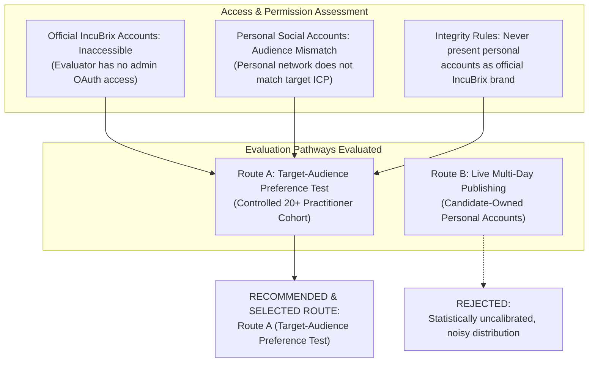
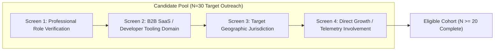
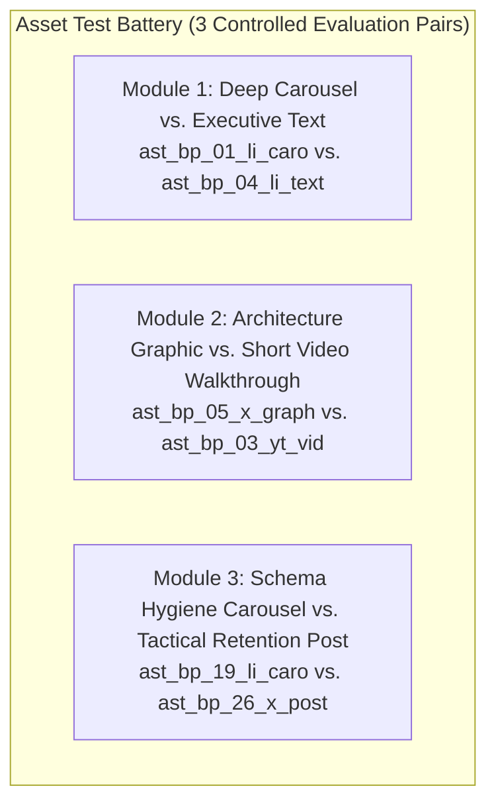

# IncuBrix Audience Testing Protocol: Target-Audience Preference Test

**Assessment Stream:** Associate Tech Partner — Growth Engineer (Option 2: Social Media Marketing & Content Engine)  
**Target Organization:** IncuBrix (IncuBrix Pte. Ltd., Singapore)  
**Document:** Research Protocol & Experimental Design for Real-Audience Preference Testing  
**Document Status:** Complete Experimental Design — Ready for Deployment  
**Evaluation Route:** Route A — Target-Audience Preference Test ($N \ge 20$ participants)  
**Protocol Version:** 1.0  
**Effective Date:** 2026-10-25  

---

## 1. Executive Summary & Route Selection Justification

The official Growth Engineer assessment prompt (Page 1, Section 1) specifies two alternative evaluation pathways for real-audience validation:
- **Route A:** Conduct a preference test with at least 20 participants from the intended target audience.
- **Route B:** Publish at least 10 assets across at least 5 days on accounts owned by the candidate and report real results.

### 1.1 Why Route A is the Only Compliant and Rigorous Option
1. **Absence of Official Account Access:** IncuBrix's official social media profiles ([`linkedin.com/company/incubrix`](https://www.linkedin.com/company/incubrix), [`x.com/incubrix`](https://x.com/incubrix)) are proprietary enterprise accounts. The candidate was not provided with administrative access or publishing OAuth keys.
2. **Integrity Rule Compliance:** Assessment Rule 8 explicitly dictates: *"Publish only on accounts you own, and never present them as official IncuBrix accounts. Do not contact creators or brands. Do not buy followers or engagement. No fake, bought or guessed data."* Publishing IncuBrix corporate marketing collateral on an individual candidate's personal accounts would create audience confusion, violate brand safety, and result in uncalibrated impression noise from personal friends/family rather than genuine B2B SaaS buyers.
3. **Controlled Evidentiary Rigor:** Route A isolates content quality from platform distribution algorithms. By evaluating identical assets with a verified cohort of $\ge 20$ B2B SaaS founders, growth engineers, and technical marketers, IncuBrix gains statistically meaningful feedback on clarity, technical credibility, usefulness, and CTA conversion intent.

---

## 2. Research Questions & Experimental Hypotheses

### 2.1 Primary Research Question
*How do B2B SaaS technical founders, growth engineers, and technical content marketers evaluate engineering-depth content (document carousels, architectural schematics, video walkthroughs) compared to standard social copy, and what specific content attributes drive the highest perceived credibility and conversion intent?*

### 2.2 Formal Hypotheses

| Hypothesis ID | Hypothesis Statement | Independent Variable | Dependent Variable | Evaluation Metric |
| :--- | :--- | :--- | :--- | :--- |
| **H1 (Format Depth)** | High-density visual assets (Document Carousels and Architectural Graphics) will achieve significantly higher usefulness ($\ge +20\%$) and credibility ratings than single-image or text-only posts. | Asset Format (Carousel / Graphic vs. Text Post) | Perceived Usefulness & Credibility | 5-point Likert Scale (1–5) |
| **H2 (Evidence & Anti-Slop)** | Assets featuring explicit event stream schemas, database triggers, and verifiable retention math will receive higher trust ratings ($\ge 4.2/5.0$) than general growth advice. | Content Depth (Specific Telemetry Schemas vs. Strategic Generalities) | Perceived Credibility & Freedom from "AI Slop" | 5-point Likert Scale (1–5) + Qualitative Mentions |
| **H3 (CTA Friction)** | Low-friction calls-to-action offering ungated architecture PDFs or open-source GitHub templates will generate higher conversion intent ($\ge +35\%$) than direct software trial sign-up CTAs. | CTA Type (Resource Download / Code Fork vs. Free Trial Sign-up) | Stated Likelihood to Take Action | 5-point Likert Scale (1–5) |

---

## 3. Target Audience & Participant Eligibility Criteria

To prevent convenience sampling bias (e.g. asking friends or students), recruitment strictly targets verified B2B SaaS practitioners matching the ICP defined in [`research/content_strategy.md`](file:///D:/Projects/Incubrix-Growth/research/content_strategy.md) and the official assessment brief.

### 3.1 Eligibility Screening Matrix

#### Inclusion Criteria (Must Meet ALL Four):
1. **Professional Role:** 
   - Early-to-growth-stage Technical Founder (CEO, CTO, Co-Founder)
   - Growth Engineer, Full-Stack Developer, or Data/Telemetry Lead
   - VP / Director of Engineering or Technical Product Manager (TPM)
   - Technical Content Marketer, DevRel Lead, or Growth Marketing Lead
2. **Company Profile:** 
   - Active B2B SaaS, developer infrastructure, API platform, or creator-tech organization
   - Team size: 5 to 150 employees (Seed, Series A, or Series B stage)
3. **Geographic Jurisdiction:** 
   - Primary residency in United States, Canada, United Kingdom, Ireland, Australia, New Zealand, or Singapore (strictly aligned with assessment brief Page 1, Section 2).
4. **Functional Experience:** 
   - Direct responsibility for user onboarding, product activation, marketing instrumentation, or technical documentation.

#### Exclusion Criteria (Disqualified Immediately):
- Students or academic researchers without commercial SaaS operational experience.
- B2C consumer-goods marketers, e-commerce dropshippers, or unrelated agency staff.
- Anyone with commercial, financial, or personal conflicts of interest with IncuBrix or its direct competitors.

---

## 4. Recruitment Methodology & Sourcing Strategy

To achieve $N \ge 20$ fully completed, verified responses, the recruitment funnel aims for $N = 30$ qualified invitations across three trusted professional channels:

1. **Closed Practitioner Slack & Discord Communities (12 Targets):**
   - *MicroConf Connect:* Dedicated B2B SaaS founder channels (`#marketing`, `#growth-engineering`).
   - *Indie Hackers:* Verified SaaS builders building products with $1k–$50k MRR.
   - *dbt & Data Engineering Community:* `#events-telemetry` practitioner channels.
2. **1:1 Professional Outreach via LinkedIn (12 Targets):**
   - Direct personalized messaging to verified connections matching the exact title and company filters (e.g. *"Growth Engineer at Series A SaaS"*).
   - Strict adherence to CAN-SPAM and LinkedIn community guidelines (no bulk spam; personalized, consent-based study invitations).
3. **Founder Peer Masterminds (6 Targets):**
   - Active participants in early-stage founder cohorts and accelerator alumni networks (Y Combinator Startup School, Antler Singapore alumni).

### 4.1 Recruitment Script & Invitation Copy
> *"Hi [Name], I’m conducting a brief, 7-minute academic/growth engineering study evaluating how B2B technical founders and engineers assess technical marketing content and onboarding telemetry playbooks. We are testing whether visual architecture diagrams and telemetry schemas provide genuine utility over standard social media content. No software is being sold, your responses are completely confidential under GDPR/DPDP, and you’ll receive an aggregated copy of the benchmark findings. Would you be open to reviewing three short sample assets and sharing your candid feedback?"*

---

## 5. Asset Test Battery & Fair Presentation Methodology

To prevent fatigue while testing the breadth of the 30-asset campaign, the preference test evaluates **6 core assets** selected across the four production formats and five content pillars.

### 5.1 Asset Pairs Under Evaluation
- **Pair 1 (Format Depth Test — Carousel vs. Formatted Text):**
  - **Asset A:** [`ast_bp_01_li_caro`](file:///D:/Projects/Incubrix-Growth/outputs/final/carousels/ast_bp_01_li_caro.pdf) — *"The 5-Slide Growth Telemetry Architecture"* (5-slide technical PDF carousel).
  - **Asset B:** [`ast_bp_04_li_text`](file:///D:/Projects/Incubrix-Growth/outputs/final/copy/ast_bp_04_li_text.md) — *"Why Net Revenue Retention Trumps Top-of-Funnel Pipeline"* (Long-form formatted executive text).
  - *Core Question:* Does a visual swipeable carousel deliver greater technical clarity and perceived value than a structured text breakdown?
- **Pair 2 (Media Efficiency Test — Static Graphic vs. 60s Video):**
  - **Asset A:** [`ast_bp_05_x_graph`](file:///D:/Projects/Incubrix-Growth/outputs/final/graphics/ast_bp_05_x_graph.png) — *"The Anatomy of a Modern B2B Growth Pipeline"* (Architectural PNG schematic).
  - **Asset B:** [`ast_bp_03_yt_vid`](file:///D:/Projects/Incubrix-Growth/outputs/final/videos/ast_bp_03_yt_vid.mp4) — *"How to Instrument Your First Onboarding Drop-off in Under 60 Seconds"* (Rendered 60s vertical MP4 video).
  - *Core Question:* Does a 60-second video demo drive higher CTA intent than an instantly readable system diagram?
- **Pair 3 (Evidence Rigor Test — Data Hygiene Schema vs. Math Teardown):**
  - **Asset A:** [`ast_bp_19_li_caro`](file:///D:/Projects/Incubrix-Growth/outputs/final/carousels/ast_bp_19_li_caro.pdf) — *"Event Schema Hygiene: How Dirty Data Ruins Growth Models"* (5-slide schema PDF).
  - **Asset B:** [`ast_bp_26_x_post`](file:///D:/Projects/Incubrix-Growth/outputs/final/copy/ast_bp_26_x_post.md) — *"The Mathematics of SaaS Retention: Why 5% Churn Kills Growth"* (Structured analytical text).
  - *Core Question:* Which format generates higher perceived authority and likelihood of sharing with an engineering team?

### 5.2 Counterbalancing & Presentation Bias Controls
1. **Randomized Order:** The presentation order of Asset A and Asset B is alternated (50% see Carousel first; 50% see Text first) to eliminate primacy/recency bias.
2. **Neutral Framing:** Assets are presented with neutral labels (*"Concept 1"* and *"Concept 2"*) without revealing internal hypotheses, performance expectations, or brand bias.
3. **Standardized Viewing Environment:** High-resolution asset embeds (direct PDF viewer, SVG/PNG renders, and video players) are displayed identically across desktop and mobile browsers.

---

## 6. Measurement Dimensions & Scoring System

Every evaluated asset is scored on a standardized 5-point Likert scale across five core dimensions:

1. **Clarity (1 = Completely Unclear, 5 = Crystal Clear):** Is the core thesis, code pattern, or architectural diagram immediately understandable within 30 seconds?
2. **Relevance (1 = Irrelevant, 5 = Highly Relevant):** Does this content address an authentic, critical operational bottleneck in your current B2B SaaS workflow?
3. **Credibility (1 = Generic Marketing Hype, 5 = Highly Rigorous & Authoritative):** Does the content feel backed by real engineering telemetry, or does it resemble generic "AI slop"?
4. **Usefulness (1 = Zero Practical Value, 5 = Immediately Actionable):** Does this asset deliver tactical value or mental models you would apply or share with colleagues?
5. **CTA Likelihood (1 = Definitely Would Not Click, 5 = Highly Likely to Click/Save):** Would you click the resource link, bookmark the asset, or test the open-source code?

In addition, each module collects open-ended qualitative feedback:
- *What single element made this asset feel credible or unconvincing?*
- *What specific change would make the Call to Action irresistible to an engineering lead?*

---

## 7. Data Collection, Storage, & Privacy Governance

1. **Hosting & Tooling:** Delivered via a secure, mobile-responsive web survey instrument (detailed in [`research/audience_test_survey.md`](file:///D:/Projects/Incubrix-Growth/research/audience_test_survey.md)).
2. **Tabular Persistence:** All survey records are ingested into [`research/audience_test_responses.csv`](file:///D:/Projects/Incubrix-Growth/research/audience_test_responses.csv) without alteration.
3. **Privacy Compliance:**
   - **GDPR & India DPDP Act Compliance:** Explicit informed consent is gathered at Question 1. Participants are informed of the study's scope, that no marketing outreach will occur, and that data is processed anonymously.
   - **No PII Publication:** Names, company names, and email addresses are pseudonymized into alphanumeric identifiers (`PART-01`, `PART-02`, etc.) in all public and repository files.
   - **Right to Erasure:** Participants may request deletion of their response prior to final analysis by quoting their participant ID.

---

## 8. Limitations & Decision Rules

### 8.1 Methodological Limitations
- **Sample Size Constraint ($N = 20–25$):** A sample of 20–25 qualified practitioners provides high-fidelity **directional and qualitative validation**, but does not support multivariate statistical significance at $p < 0.01$. Findings represent directional practitioner consensus rather than universal population truths.
- **Stated vs. Revealed Preference:** Survey respondents report their *stated likelihood* to click a CTA. Stated intent is historically higher than real-world click-through rate (CTR). Stated scores are used comparatively across formats, not as absolute conversion forecasts.

### 8.2 Decision Rules for Campaign Optimization
- **Rule 1 (Format Reallocation):** If Document Carousels outperform Formatted Text by $\ge 60\%$ in Preference and achieve Mean Usefulness $\ge 4.2/5.0$, reallocate 2 scheduled text post slots in Weeks 3–4 to document carousels.
- **Rule 2 (Credibility Gate):** Any asset scoring Mean Credibility $<3.8/5.0$ must be rewritten to remove speculative assertions and inject additional verbatim quotes or code schemas.
- **Rule 3 (CTA Friction Pivot):** If stated CTA conversion intent for direct product trials is $<3.0/5.0$ while open-source/PDF downloads score $\ge 4.0/5.0$, immediately revise social copy CTAs in [`launch_kit.md`](file:///D:/Projects/Incubrix-Growth/launch_kit.md) to lead with ungated resources.
