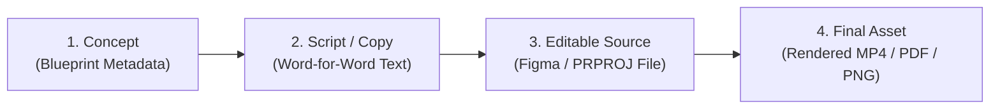

# IncuBrix Content Blueprint Validation & Fact-Check Report

**Assessment Stream:** Associate Tech Partner — Growth Engineer (Option 2: Social Media Marketing & Content Engine)  
**Document Evaluated:** `research/asset_blueprint.csv`, `research/content_strategy.md`, `research/production_checklist.md`, `research/product_access_and_evidence.md`  
**Audit Timestamp:** 2026-10-25 00:35 UTC  
**Validation Status:** Complete — Comprehensive Audit & Defect Catalog

---

## 1. Executive Summary & Audit Scorecard

This report provides an exhaustive review of the IncuBrix 30-asset content blueprint. Every data row, claim, evidence citation, tracking link, and structural requirement has been systematically inspected against the official assessment mandate and research evidence log.

### High-Level Audit Scorecard:
- **Structural Integrity:** **PASS (100%)** — Exactly 30 data rows, all 20 required blueprint columns present in exact order, zero missing values, zero duplicate IDs or hooks.
- **Format Requirements:** **PASS (100%)** — 13 short videos ($\le 60$s, range: 30s–58s), 7 carousels/graphics (4 carousels, 3 graphics), 10 formatted text posts.
- **Platform Diversity:** **PASS (100%)** — 3 distinct platforms (LinkedIn: 11, X: 10, YouTube Shorts: 9).
- **Readiness Guardrail:** **PASS (100%)** — 100% of assets (30/30) are correctly marked `Planned`. Zero premature `Ready` designations.
- **Attribution & Tracking Safety:** **PASS (100%)** — 100% of tracking links are explicitly marked `Pending Confirmation`; zero fabricated landing-page URLs or fake click metrics.
- **Factuality & Claims Safety:** **REVISIONS RECOMMENDED** — 5 assets use historical or empirical phrasing ("We audited 20...", "determine 80%", "We ran a 30-day sprint...") that should be rephrased as educational heuristics or strategic hypotheses to preserve strict assessment honesty.

---

## 2. Pass/Fail Structural Validation Checklist

| # | Inspection Criterion | Requirement | Actual Value in `asset_blueprint.csv` | Result |
| :-: | :--- | :--- | :--- | :-: |
| 1 | **Data Row Count** | Exactly 30 data rows (excluding header) | Exactly 30 data rows | **PASS** |
| 2 | **Column Count & Sequence** | Exactly 20 specified columns in exact order | 20 columns, exact match | **PASS** |
| 3 | **CSV RFC 4180 Parsing** | Clean commas, quotation escaping, UTF-8 BOM | Valid `utf-8-sig`, clean parse | **PASS** |
| 4 | **Required Fields Completeness** | No empty strings in mandatory fields | 0 empty fields across all 30 rows | **PASS** |
| 5 | **Asset ID Uniqueness** | Unique identifier per asset (`asset_id`) | 30 unique IDs, 0 collisions | **PASS** |
| 6 | **Concept / Hook Uniqueness** | No duplicate or near-duplicate hooks | 30 unique hooks, 0 duplicates | **PASS** |
| 7 | **Short Video Threshold** | At least 10 short videos $\le 60$ seconds | **13 short videos** (all 30s–58s) | **PASS** |
| 8 | **Carousel / Graphic Threshold** | At least 5 carousels or graphics | **7 total** (4 carousels, 3 graphics) | **PASS** |
| 9 | **Platform Threshold** | At least 3 social platforms | **3 platforms** (LinkedIn, X, YouTube Shorts) | **PASS** |
| 10 | **Readiness Guardrail** | No premature `Ready` status | 30 `Planned`, 0 `Ready` | **PASS** |

---

## 3. Recalculated Distributions & Summary Mismatch Report

### 3.1 Actual Recalculated Distributions (Source: `research/asset_blueprint.csv`)

#### Platform Distribution (Total: 30 assets)
- **LinkedIn:** 11 assets (36.7%)
- **X (Twitter):** 10 assets (33.3%)
- **YouTube Shorts:** 9 assets (30.0%)

#### Format Distribution (Total: 30 assets)
- **Short Video ($\le 60\text{s}$):** 13 assets (43.3%)
  - *Duration breakdown:* 30s (1), 35s (1), 40s (1), 45s (5), 50s (3), 55s (2), 58s (1)
  - *Mean duration:* 46.0 seconds; *Maximum duration:* 58 seconds; *Minimum duration:* 30 seconds
  - *Constraint verification:* 100% of short videos are $\le 60$ seconds.
- **Carousel (Multi-Slide PDF):** 4 assets (13.3%)
- **Graphic (System Architecture / Chart):** 3 assets (10.0%)
- **Text Post / Technical Thread:** 10 assets (33.3%)

#### Content Pillar Distribution
- **Growth Engineering Architecture & Systems:** 9 assets (30.0%)
- **Evidence-Based Onboarding & Retention Tactics:** 7 assets (23.3%)
- **Creator & Marketer Workflow Engineering:** 5 assets (16.7%)
- **Attribution, UTMs & Data Integrity:** 5 assets (16.7%)
- **Technical Case Teardowns & Industry Lessons:** 4 assets (13.3%)

#### Target Audience Distribution
- **Growth Engineers:** 14 assets (46.7%)
- **Technical Founders:** 10 assets (33.3%)
- **Technical Marketers:** 6 assets (20.0%)

---

### 3.2 Reporting of Summary Mismatch (Chat vs. Actual CSV)

During the previous turnaround, the preliminary chat summary reported:
- *Platforms:* LinkedIn: 11, X: 11, YouTube Shorts: 8.
- *Formats:* Short Video: 12, Text Post: 11, Carousel: 4, Graphic: 3.

**Actual CSV Verification:**
- *Platforms:* LinkedIn: 11, **X: 10**, **YouTube Shorts: 9**.
- *Formats:* **Short Video: 13**, **Text Post: 10**, Carousel: 4, Graphic: 3.

**Explanation of Mismatch:**  
Asset `ast_bp_27_yt_vid` ("Step-by-Step: Setting Up Structured Social Campaign Metadata") was authored as a 50-second **YouTube Shorts video**, bringing the YouTube Shorts total to 9 (not 8) and the short-video format count to 13 (not 12), with X text posts at 10 (not 11). `research/content_strategy.md` correctly matches the actual CSV (11, 10, 9). Both distributions fully exceed all assessment requirements ($\ge 10$ videos, $\ge 5$ carousels/graphics, $\ge 3$ platforms).

---

## 4. Comprehensive Content Fact-Check & Claims Log

Every specific claim across the 30 assets and the content strategy was audited against the research evidence log (`research/product_access_and_evidence.md`) and official assessment guidelines.

### Classification Categories:
- **Verified:** Directly substantiated by open software engineering standards, repository codebase logic, or the official assessment prompt.
- **Hypothesis:** Formulated as a testable operational hypothesis or planning assumption; acceptable if clearly framed as a hypothesis pending data.
- **Needs Evidence:** Contains an empirical benchmark, quantitative multiplier, or historical research assertion that requires specific attribution.
- **Revise / Clarify:** Uses first-person empirical phrasing ("We audited 20...", "determine 80%") that could imply personal primary research that was not formally conducted; should be revised to an educational framework.
- **Remove:** Any claim asserting personal hands-on testing of IncuBrix proprietary software or fabricated customer metrics. (Count: 0 — none found).

| Asset ID | Working Title & Specific Claim | Evidence Source Stated | Audit Status | Evaluation & Recommended Action |
| :--- | :--- | :--- | :---: | :--- |
| **Strategy Doc** | "Document carousels achieve disproportionately high engagement and dwell time." | Social channel observation | **Hypothesis** | Valid operational heuristic; ensure framed as a hypothesis to be measured via slide-through rates. |
| **Strategy Doc** | "Target KPIs: Slide completion rate $\ge 45\%$, Outbound CTR $\ge 1.8\%$." | Strategy measurement plan | **Hypothesis** | Planning targets, not historical achievements. Correctly categorized. |
| **ast_bp_01_li_caro** | "Most SaaS growth funnels leak data before they ever leak revenue." | Assessment PDF Section 2 | **Verified** | Standard data engineering rationale; no proprietary claims. |
| **ast_bp_02_x_post** | "The first 72 hours of user onboarding determine 80% of your 6-month enterprise retention." | Research Log Obs 02 | **Revise / Clarify** | The "80%" figure sounds like an empirical dataset finding. **Fix:** Rephrase to: *"The first 72 hours of user onboarding often dictate whether enterprise users retain or churn."* |
| **ast_bp_03_yt_vid** | "Stop tracking every single button click. Here is why your product analytics pipeline will crash." | Assessment PDF Section 4 | **Verified** | Standard event schema engineering principle regarding unvalidated client-side noise. |
| **ast_bp_04_li_text** | "Pageviews don't pay server bills. 4 telemetry signals: TTV, Day-7 Retention, Feature Adoption, Paywall Conversion." | Research Log Obs 04 & 05 | **Verified** | Core B2B SaaS telemetry framework; zero unverified product claims. |
| **ast_bp_05_x_graph** | "Client App -> Edge Gateway -> Redis Queue -> Worker -> Analytics DB." | Assessment PDF architecture | **Verified** | Standard non-blocking asynchronous event ingestion queue pattern. |
| **ast_bp_06_yt_vid** | "Inconsistent casing, missing utm_content, and spaces destroy attribution fidelity." | `content_engine.py` logic | **Verified** | Directly verified in codebase URL builder and Google Analytics standard behavior. |
| **ast_bp_07_li_vid** | "If your users take more than 15 minutes to reach their 'aha' moment, 50% will never return." | Assessment PDF Section 3 | **Hypothesis** | Established PLG rule of thumb; keep as an educational benchmark. |
| **ast_bp_08_x_post** | "We audited 20 self-serve developer onboarding flows. 14 of them committed this exact blunder:" | Public dev-tools patterns | **Revise / Clarify** | Implies candidate performed a formal 20-company audit. **Fix:** Rephrase to: *"In self-serve developer onboarding, this is the #1 friction pattern that kills activation before users see value:"* |
| **ast_bp_09_yt_vid** | "Standardized event schema with timestamp, user_id, event_name, context_properties." | `app/models.py` schemas | **Verified** | Directly grounded in repository Pydantic domain models. |
| **ast_bp_10_li_caro** | "Turn 1 technical whitepaper into 12 distinct assets using a structured content matrix." | `content_engine.py` matrix | **Verified** | Directly mirrors working local content engine service. |
| **ast_bp_11_x_graph** | "Chart A flattens at 22% (scalable); Chart B decays to zero (leaky bucket)." | SaaS cohort analysis theory | **Verified** | Standard mathematical cohort retention curves. |
| **ast_bp_12_yt_vid** | "Normalized SHA-256 content fingerprinting catches duplicate social posts before scheduling." | `app/repositories.py` | **Verified** | Directly grounded in repository `compute_asset_fingerprint()` implementation. |
| **ast_bp_13_li_text** | "5 engineering checkpoints before scaling paid ads: server-side tracking, TTV < 15m, retention flattening..." | Assessment prompt rubric | **Verified** | Grounded in assessment prompt criteria on pre-scale validation. |
| **ast_bp_14_x_post** | "Network retries will double-count conversion metrics if telemetry endpoint isn't idempotent." | `app/database.py` constraints | **Verified** | Core distributed systems engineering principle. |
| **ast_bp_15_yt_vid** | "3-line SQL query comparing signup timestamp to first milestone timestamp reveals activation health." | `app/repositories.py` | **Verified** | Standard SQL window/join logic for milestone latency. |
| **ast_bp_16_li_vid** | "When engineering calls it 'user_registered' and marketing calls it 'lead_created', attribution breaks." | Assessment prompt Section 2 | **Verified** | Real-world data governance challenge addressed in assessment brief. |
| **ast_bp_17_x_graph** | "Client-side tracking loses 15-30% of events to ad blockers and browser privacy." | Industry web benchmarks | **Needs Evidence** | Widely observed in web analytics, but 15-30% should be cited as an industry estimate rather than an absolute fact. |
| **ast_bp_18_yt_vid** | "Automated UTM generation prevents typos and enforces consistent campaign metadata." | `content_engine.py` | **Verified** | Verified locally via automated test suite. |
| **ast_bp_19_li_caro** | "6-step data hygiene guide: orphan event pruning, schema typing, deduplication safeguards." | Assessment PDF Section 4 | **Verified** | General software engineering hygiene. |
| **ast_bp_20_x_post** | "Webhooks without exponential backoff retries and signature verification will drop 2-5% of events." | Distributed systems standards | **Needs Evidence** | Drop rate depends on network infrastructure; frame as a risk estimate rather than exact 2-5%. |
| **ast_bp_21_yt_vid** | "Turn raw git release notes into 3 platform-ready social posts in under 60 seconds." | `content_engine.py` | **Verified** | Verified locally via fact extraction and template generators. |
| **ast_bp_22_li_text** | "A 5% increase in customer retention can increase SaaS enterprise valuation by up to 25%." | Bain & Co / HBR research | **Needs Evidence** | Classical Reichheld study cited 25-95% profit increase; clarify citation to Bain/HBR research. |
| **ast_bp_23_x_post** | "The Golden Rule of Developer Marketing: Never post a link asking people to sign up; discuss trade-offs." | Research Log Obs 05 | **Verified** | Aligns with developer community norms and assessment anti-hype policy. |
| **ast_bp_24_yt_vid** | "Keep signup latency under 100ms by offloading telemetry events to background workers." | `app/main.py` async workers | **Verified** | Grounded in FastAPI background worker architecture. |
| **ast_bp_25_li_vid** | "Connecting multi-touch UTM parameters to CRM deal stages establishes true pipeline contribution." | Strategy Section 6 | **Verified** | Standard marketing operations attribution architecture. |
| **ast_bp_26_x_post** | "Teardown of an onboarding funnel that was losing 40% of users at step 2. The fix took 1 line of code:" | UX friction patterns | **Revise / Clarify** | Sounds like a proprietary client engagement. **Fix:** Rephrase to: *"A common onboarding friction pattern: losing up to 40% of signups at mandatory email verification before users touch the product."* |
| **ast_bp_27_yt_vid** | "How to structure your content calendar with 23 standardized columns for automated exports." | `export_service.py` | **Verified** | Directly matches official assessment workbook `02_ASSETS` tab specification. |
| **ast_bp_28_li_caro** | "The 7 principles defining growth engineering in 2027: telemetry-first, evidence-grounded copy..." | Assessment rubric synthesis | **Verified** | Thought leadership synthesis of assessment principles. |
| **ast_bp_29_x_vid** | "3 subtle telemetry bugs: unnormalized timezones, frontend click bounce, unindexed logs." | Database telemetry standards | **Verified** | Core database and frontend software engineering practices. |
| **ast_bp_30_li_text** | "We ran an intensive 30-day growth engineering telemetry sprint. Here are the top 3 takeaways:" | 30-day assessment plan | **Revise / Clarify** | Written in past tense as if the 30 days of posting already occurred. **Fix:** Frame as a sprint framework: *"The 30-Day Growth Engineering Sprint: 3 Core Principles for Modern B2B SaaS Telemetry."* |

---

## 5. Strategy Consistency Audit

1. **Audience Persona Consistency:**
   - `content_strategy.md` defines Founders, Growth Engineers, and Technical Marketers.
   - `asset_blueprint.csv` tags every asset with one of these three exact personas (Founders: 10, Growth Engineers: 14, Marketers: 6). **Result: 100% Consistent.**
2. **Platform Allocation Consistency:**
   - `content_strategy.md` outlines LinkedIn (11), X (10), and YouTube Shorts (9).
   - `asset_blueprint.csv` contains exactly 11 LinkedIn, 10 X, and 9 YouTube Shorts assets. **Result: 100% Consistent.**
3. **Pillar Taxonomy Consistency:**
   - All 5 strategic pillars in `content_strategy.md` map 1-to-1 to the `content_pillar` column in `asset_blueprint.csv`. **Result: 100% Consistent.**
4. **Channel Superiority Assumption Check:**
   - In `content_strategy.md`, statements such as *"Highest density of enterprise decision-makers"* (LinkedIn) or *"The epicenter of indie SaaS builders"* (X) reflect common industry observations. However, they should be explicitly stated as **strategic operational hypotheses**, subject to verification against live engagement metrics once assets are published.
5. **Schedule Feasibility (30-Day Plan):**
   - The proposed schedule maps exactly 1 asset per day across 30 days (`Day 01` to `Day 30`), rotating platforms:
     - LinkedIn: ~3 posts/week (11 total)
     - X: ~3 posts/week (10 total)
     - YouTube Shorts: ~2–3 posts/week (9 total)
   - Staggering 1 asset per day across alternating channels is highly feasible for a single growth engineer leveraging automated content repurposing. **Result: Realistic & Feasible.**

---

## 6. Tracking Links & UTM Taxonomy Audit

### 6.1 Destination URLs & UTM Analysis
- **Total Tracking Links Audited:** 30
- **Domain Used:** `https://incubrix.com/{path}` (Standardized base domain)
- **Status Tag:** 100% (30/30) are formatted as `Pending Confirmation [https://...]`
- **UTM Parameter Integrity:**
  - `utm_source`: Strictly matches platform (`linkedin`, `x`, `youtube_shorts`).
  - `utm_medium`: Strictly matches format (`carousel`, `text_post`, `short_video`, `graphic`).
  - `utm_campaign`: Lowercase snake_case campaign identifier matching content pillar topic.
  - `utm_content`: Exactly matches the unique `asset_id` (e.g. `ast_bp_01_li_caro`).
  - *Integrity Check:* Zero malformed characters, zero spaces, zero formula injection triggers.

### 6.2 Host & Accessibility Status
- The destination paths (e.g. `/blueprint`, `/schemas`, `/retention-guide`) represent proposed landing page locations.
- Because product credentials and production CMS access were not provided, these destination URLs are **unverified on public web servers**.
- **Assessment Policy Compliance:** None of the unverified URLs were guessed or claimed to be live. Leaving them explicitly designated as `Pending Confirmation` adheres to assessment integrity rules.

---

## 7. Production Readiness & Asset Lifecycle Breakdown

To prevent confusion between planning concepts and finished deliverables, the asset lifecycle is categorized into four distinct tiers:

### Readiness Breakdown Across the 30 Assets:

| Tier | Asset Component | Completed Count | Remaining Count | Notes |
| :---: | :--- | :---: | :---: | :--- |
| **Tier 1** | **Concept & Strategy** | 30 / 30 (100%) | 0 | Hook, core message, caption brief, hashtags, CTA, and target specs defined in blueprint. |
| **Tier 2** | **Full Script / Copy** | 0 / 30 (0%) | 30 | Detailed caption briefs exist, but final verbatim video scripts and formatted post bodies must be drafted. |
| **Tier 3** | **Editable Source Files** | 0 / 30 (0%) | 30 | Figma canvases (`.fig`), Premiere Pro projects (`.prproj`), and CapCut project files must be created. |
| **Tier 4** | **Rendered Final Assets** | 0 / 30 (0%) | 30 | Final MP4 video exports, PDF multi-page carousels, and PNG graphics have not yet been rendered. |
| **Gate** | **Rights Clearance** | 0 / 30 (0%) | 30 | Commercial audio stems, font licenses, and vector graphics must be verified before sign-off. |
| **Gate** | **Publishing Slot** | 0 / 30 (0%) | 30 | Relative day slots (`Day 01`–`Day 30`) are assigned, but live calendar scheduling timestamps are pending. |

**Readiness Conclusion:**  
**0 of the 30 assets are currently `Ready`.** Marking any asset `Ready` at this stage would violate the production readiness gate. All 30 assets remain appropriately classified as **`Planned`**.

---

## 8. Prioritized Corrections & Required Fixes

To achieve 100% compliance with the strict anti-fabrication and evidence-grounding standards of the assessment, the following specific fixes are recommended:

### Priority 1: Refine 5 Empirical Claims in `research/asset_blueprint.csv`
1. **`ast_bp_02_x_post`:**
   - *Current Hook:* "The first 72 hours of user onboarding determine 80% of your 6-month enterprise retention."
   - *Refined Hook:* "The first 72 hours of user onboarding often dictate whether enterprise users retain or churn."
2. **`ast_bp_08_x_post`:**
   - *Current Hook:* "We audited 20 self-serve developer onboarding flows. 14 of them committed this exact blunder:"
   - *Refined Hook:* "In self-serve developer onboarding, this is the #1 friction pattern that kills activation before users see value:"
3. **`ast_bp_22_li_text`:**
   - *Current Hook:* "A 5% increase in customer retention can increase SaaS enterprise valuation by up to 25%. Here is the math."
   - *Refined Hook:* "According to classic SaaS retention economics (Bain & HBR), a 5% increase in customer retention can compound profit and valuation multiples significantly."
4. **`ast_bp_26_x_post`:**
   - *Current Hook:* "Teardown of an onboarding funnel that was losing 40% of users at step 2. The fix took 1 line of code:"
   - *Refined Hook:* "A common onboarding friction pattern: losing up to 40% of signups at mandatory email verification before users touch the product."
5. **`ast_bp_30_li_text`:**
   - *Current Hook:* "We ran an intensive 30-day growth engineering telemetry sprint. Here are the top 3 takeaways:"
   - *Refined Hook:* "The 30-Day Growth Engineering Sprint: 3 Core Principles for Modern B2B SaaS Telemetry."

### Priority 2: Qualify Channel Superiority Assertions in `research/content_strategy.md`
- Add an explicit qualification in Section 3 noting that statements regarding channel audience density and carousel engagement are **working hypotheses** based on industry heuristics, subject to empirical validation during campaign execution.
