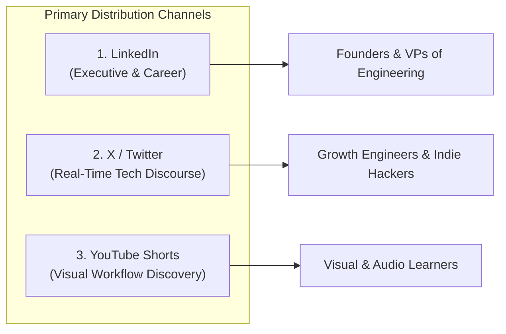
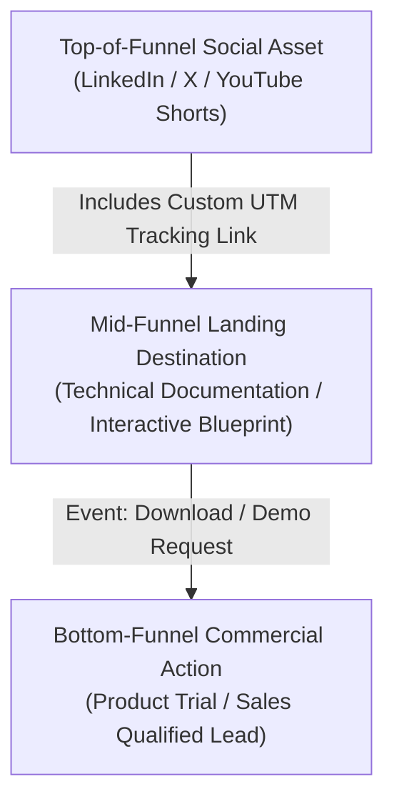

# IncuBrix Content Strategy & Distribution Plan

**Assessment Stream:** Associate Tech Partner — Growth Engineer (Option 2: Social Media Marketing & Content Engine)  
**Document:** Content Strategy, Platform Allocation, Brand Voice, and Measurement Framework  
**Target Organization:** IncuBrix  
**Status:** Strategy Draft — Aligned with Assessment PDF & Research Evidence Log

---

## 1. Executive Summary & Strategy Objectives

This content strategy establishes an evidence-based, developer-grade organic growth engine for IncuBrix. Rather than relying on generic AI marketing hype, speculative growth promises, or unsubstantiated claims, the strategy positions IncuBrix around **growth engineering rigor**, **verifiable telemetry**, and **practical SaaS architecture**.

### Primary Objectives:
1. **Build Technical Authority:** Establish credibility with B2B technical founders, CTOs, and growth engineers through substantive breakdowns of onboarding telemetry and retention engineering.
2. **Drive High-Intent Traffic:** Funnel qualified practitioners from top-of-funnel social discovery into structured conversion assets (whitepapers, architecture teardowns, live telemetry blueprints) using granular UTM attribution.
3. **Ensure 100% Brand Safety & Integrity:** Enforce strict editorial guardrails that prohibit fabricated customer claims, unverified metrics, or unauthorized claims of hands-on platform evaluation.

---

## 2. Target Audience & Practitioner Segments

The content strategy addresses three distinct buyer and practitioner personas in the modern B2B SaaS ecosystem:

### Segment 1: Early-to-Growth-Stage Technical Founders (Seed to Series A)
- **Profile:** Technical founders, CEO/CTOs of developer-focused or B2B SaaS companies with 5–50 employees.
- **Pain Points:** High customer acquisition cost (CAC) paired with leaky onboarding funnels; scaling ad spend before establishing cohort retention; lack of dedicated growth data infrastructure.
- **Content Resonance:** High-level strategic teardowns, ROI of telemetry instrumentation, cohort retention benchmarks, capital-efficient growth frameworks.

### Segment 2: Growth Engineers & Product Technical Leads
- **Profile:** Software engineers specializing in growth pipelines, full-stack developers instrumenting user journeys, and technical product managers.
- **Pain Points:** Brittle custom event tracking; disconnect between marketing webhooks and core application state; tedious manual repurposing of technical documentation.
- **Content Resonance:** Code snippets, architectural flowcharts, event schema designs, automated content pipelines, UTM taxonomy hygiene.

### Segment 3: Technical Content Marketers & Growth Hackers
- **Profile:** B2B marketing technologists, dev-rel leads, and growth marketers operating in developer tooling and enterprise software.
- **Pain Points:** Translating dense engineering release notes into engaging social copy; maintaining high post frequency without diluting technical depth; avoiding superficial AI-generated fluff.
- **Content Resonance:** Multi-format repurposing playbooks, carousel frameworks, video script templates, editorial quality checklists.

---

## 3. Platform Selection & Evidence-Based Justification

To maximize organic discoverability, format diversity, and qualified pipeline generation, three primary social platforms have been selected:

### 1. LinkedIn (11 Planned Assets)
- **Strategic Role:** Core B2B demand generation and executive thought leadership.
- **Audience Concentration:** Highest density of enterprise decision-makers, venture-backed founders, and engineering managers.
- **Native Format Affinity:** Document carousels (PDF swipeables) achieve disproportionately high engagement and dwell time; formatted text teardowns drive substantive comments.
- **Pacing:** 3 posts/week (Monday, Wednesday, Friday mornings).

### 2. X / Twitter (10 Planned Assets)
- **Strategic Role:** Real-time engineering discourse, technical debate, and rapid hook testing.
- **Audience Concentration:** The epicenter of indie SaaS builders, dev-tools creators, and growth hackers discussing product metrics openly.
- **Native Format Affinity:** High-density bulleted posts, architectural graphic cards, and punchy single-concept takeaways that invite reposts and bookmarks.
- **Pacing:** 3–4 posts/week (Tuesday, Thursday, Saturday afternoons).

### 3. YouTube Shorts (9 Planned Assets)
- **Strategic Role:** Evergreen algorithmic discovery and rapid visual demonstration.
- **Audience Concentration:** Modern software developers and technical marketers who consume tutorial and workflow content via vertical video.
- **Native Format Affinity:** Under-60-second split-screen walkthroughs, kinetic code/flowchart overlays, and visual teardowns with lasting Google Search indexing.
- **Pacing:** 2–3 videos/week (Tuesday, Friday, Sunday).

> [!NOTE]
> **Channel Selection Heuristic & Hypothesis Notice:**  
> Observations regarding channel audience concentration and format engagement (e.g. LinkedIn carousel dwell time, X developer discourse density) are based on broader B2B SaaS marketing heuristics. They are formulated here as **working distribution hypotheses** to be measured empirically against live campaign performance, rather than definitive historical proofs.

---

## 4. Five Strategic Content Pillars

All 30 planned assets map directly to five distinct content pillars:

| Pillar ID | Pillar Name | Strategic Objective | Core Themes & Formats |
| :--- | :--- | :--- | :--- |
| **P1** | **Growth Engineering Architecture & Systems** | Establish technical depth and platform authority | Telemetry pipelines, event stream schemas, database triggers, webhooks, system diagrams. |
| **P2** | **Evidence-Based Onboarding & Retention Tactics** | Address critical operational pain points of B2B founders | First-72-hour activation, cohort retention loops, time-to-value acceleration, churn diagnostics. |
| **P3** | **Creator & Marketer Workflow Engineering** | Provide actionable playbooks for content operations | Source document repurposing, multi-platform adaptation, prompt structure, editorial guardrails. |
| **P4** | **Attribution, UTMs & Data Integrity** | Champion measurement rigor and transparency | UTM taxonomy design, campaign naming conventions, content fingerprint deduplication, anti-vanity metrics. |
| **P5** | **Technical Case Teardowns & Industry Lessons** | Ground concepts in relatable industry realities | Real SaaS onboarding teardowns, growth anti-patterns, feature announcement post-mortems. |

---

## 5. Brand Voice Rules & Prohibited Claims

### Tone and Voice Principles:
- **Pragmatic & Analytical:** Write like an experienced growth engineer speaking to peers. Use precise terminology (e.g. *cohort retention*, *latency*, *idempotency*) without gratuitous jargon.
- **Evidence-Grounded:** Every claim must be tied to a logical framework, documented metric, or verified source quote.
- **Respectful of Practitioner Intelligence:** Avoid condescending beginner tropes ("Did you know marketing matters?"). Dive straight into the insight.
- **Transparent Regarding Tooling:** Be explicit about automation, human review, and the boundaries of current testing.

### Strict Prohibitions & Red Lines:
1. **No Fabricated Customer Proof:** Never invent customer names, case studies (e.g., "SaaS X grew 400%"), fictitious quotes, or simulated dashboard screenshots.
2. **No Claims of Hands-On Product Testing:** The candidate was not provided product credentials; copy must never imply personal hands-on testing of IncuBrix proprietary software.
3. **No Unsubstantiated Algorithmic Superlatives:** Avoid phrases like *"proprietary AI that guarantees viral reach"* or *"10x your pipeline overnight"*.
4. **No Direct Public Publishing Without Approval:** Content assets remain strictly in staging (`Planned`/`Draft`) until creative files exist and rights clearance is verified.

---

## 6. Social-to-Signup Measurement Plan

To ensure every asset is measurable and tied to commercial pipeline creation, a three-stage attribution architecture is enforced:

### 1. UTM Taxonomy Architecture
Every link uses a structured, machine-parsable parameter format:
`https://incubrix.com/{destination_path}?utm_source={platform}&utm_medium={format}&utm_campaign={campaign_name}&utm_content={asset_id}`

- **`utm_source`:** Canonical platform (`linkedin`, `x`, `youtube_shorts`).
- **`utm_medium`:** Asset format (`carousel`, `text_post`, `short_video`, `graphic`).
- **`utm_campaign`:** Campaign objective (e.g. `growth_telemetry_2027`, `onboarding_blueprints`).
- **`utm_content`:** Unique asset identifier (e.g. `ast_bp_01_li_caro`).

### 2. Primary Key Performance Indicators (KPIs)
- **Top of Funnel:**
  - Carousels: Slide completion rate (target $\ge 45\%$).
  - Short Videos: 30s View-through rate (target $\ge 35\%$), average watch time.
  - Text/Graphics: Repost/Bookmark rate (target $\ge 2.5\%$).
- **Mid Funnel:**
  - Outbound Click-Through Rate (CTR) via tracking link (target $\ge 1.8\%$).
  - Dwell time on destination technical page (target $\ge 90\text{s}$).
- **Bottom Funnel:**
  - Conversion rate from landing visit to whitepaper download or demo waitlist (target $\ge 8\%$).

---

## 7. Tooling Stack & AI Disclosure Policy

### Content Creation & Production Stack:
- **Design & Layout:** Figma (Primary for vector graphics & carousels), Canva Pro (alternative templates).
- **Video Editing & Animation:** CapCut / DaVinci Resolve (9:16 vertical video pacing, kinetic typography, audio normalization).
- **Screen Recording:** OBS Studio (1080x1920 / 1920x1080 lossless capture).
- **Text & Metadata Automation:** IncuBrix Content Engine (Python rule-based text parser, fact extraction, and CSV/JSON export service).

### Transparent AI Disclosure:
- In compliance with platform policies and ethical engineering standards:
  - Any copy or conceptual framework utilizing generative AI is flagged in metadata as `ai_label_needed: Yes`.
  - Content generated purely through deterministic templates or manual authoring is marked `ai_label_needed: No`.
  - Rights clearance (`rights_checked`) remains `Pending` until human editors verify visual and audio assets.
