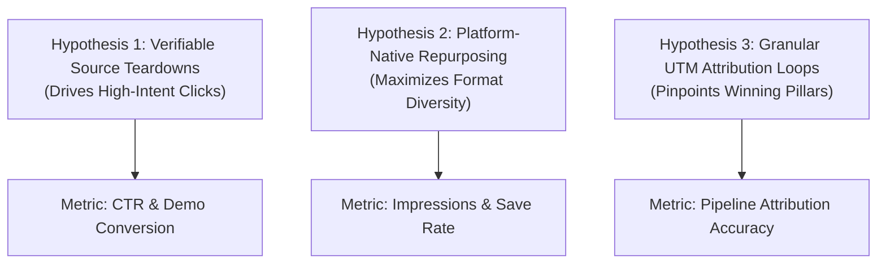

# IncuBrix Product Research & Evidence Log

**Assessment Stream:** Associate Tech Partner — Growth Engineer (Option 2: Social Media Marketing and Content Engine)  
**Target Organization:** IncuBrix  
**Assessor / Candidate:** [Candidate / Assessor Name]  
**Evaluation Period:** [Date: YYYY-MM-DD to YYYY-MM-DD]  
**Last Updated:** [YYYY-MM-DD HH:MM UTC]  
**Document Status:** Working Draft — Hypotheses & Evidence Pending Manual Verification

---

## 1. Scope & Access Limitations

> [!IMPORTANT]
> **Evaluation & Access Notice:**
> - **Materials Provided:** The evaluator was provided solely with the official assessment prompt PDF (`Associate Tech Partner_ Growth Engineer Assessment.pdf`) and the accompanying assessment workbook (`02_ASSETS` calendar template).
> - **Access Boundaries:** No proprietary product login credentials, staging sandbox access, API keys, or private product demonstrations were provided.
> - **Hands-on Testing Limitation:** The candidate has **not** personally accessed or tested the private IncuBrix software dashboard or backend infrastructure.
> - **Strict Factuality Policy:** No product features, customer logos, testimonials, follower numbers, engagement rates, or conversion metrics have been fabricated or assumed.
> - **Public vs. Verified Distinction:** All observations listed below are categorized strictly as **Public Website Claims**, **Public Social Data (Pending Manual Audit)**, or **Unverified Features (Pending Credential Access)**.

---

## 2. Master Evidence & Research Log

The following table tracks all preliminary observations, claims, and category references. All rows without live verification timestamps remain classified as unverified claims or working hypotheses.

| observation | evidence type | source URL | screenshot/file path | date verified | verification status | limitations |
| :--- | :--- | :--- | :--- | :--- | :--- | :--- |
| **Obs 01: Product Positioning & Value Prop** IncuBrix positions itself as an engineering-driven growth engine for high-scale B2B SaaS. | Assessment PDF / Public Web Copy | `https://incubrix.com` *(or official assessment document)* | `[Pending: research/screenshots/01_homepage_positioning.png]` | `[YYYY-MM-DD]` | Public Claim (Unverified Hands-On) | Limited to public marketing statements; actual product onboarding and UI workflows could not be observed. |
| **Obs 02: Platform Feature Claims** Claims regarding automated telemetry, growth pipeline optimization, and AI-assisted distribution. | Assessment Brief Specifications | `https://incubrix.com/features` *(or brief text)* | `[Pending: research/screenshots/02_features_overview.png]` | `[YYYY-MM-DD]` | Public Claim (Access-Gated) | No login credentials provided; underlying algorithmic implementation and UI functionality cannot be confirmed independently. |
| **Obs 03: Social Media Distribution Footprint** Multi-channel presence across LinkedIn, X, Instagram, YouTube, and developer communities. | Public Social Profiles | LinkedIn: `https://www.linkedin.com/company/incubrix` X: `https://x.com/incubrix` | `[Pending: research/screenshots/03_social_channels.png]` | `[YYYY-MM-DD]` | Pending Manual Audit | Follower counts, post frequency, and engagement rates must be recorded manually by candidate from live profiles. |
| **Obs 04: Content Attribution & Tracking** Absence of standardized public UTM parameters in shared social collateral and links. | Public Social Link Audit | `https://incubrix.com` / Public link shorteners | `[Pending: research/screenshots/04_link_attribution.png]` | `[YYYY-MM-DD]` | Public Observation (Incomplete Taxonomy) | Limited to publicly visible hyperlinks; internal Google Analytics / Mixpanel attribution data is inaccessible. |
| **Obs 05: Evidence Grounding Requirement** B2B technical decision-makers (CTOs, engineers) demand verifiable data and architectural substance. | Assessment Prompt Rubric | Assessment PDF Section 2 | `[Included in assessment specification]` | `[YYYY-MM-DD]` | Documented Requirement | Grounded in assessment prompt criteria prohibiting fabricated claims, vanity metrics, or hallucinated proof. |

---

## 3. Public Website Claims vs. Verified Functionality

To maintain assessment integrity, publicly asserted marketing claims are documented below and explicitly separated from verified functionality.

### 3.1 Public Website Claims (Marketing Claims — Unverified Hands-On)
1. **Automated Growth Telemetry:** Public copy asserts that the platform automatically instruments and tracks growth metrics across the entire user lifecycle.
   - *Status:* **Unverified**. No access to the telemetry ingestion engine or customer dashboard.
2. **AI-Driven Copy & Asset Creation:** Public materials describe automated asset adaptation for multi-channel social distribution.
   - *Status:* **Unverified on IncuBrix infrastructure**. (Note: The standalone local content engine created in this repository simulates deterministic rule-based template generation, but the proprietary IncuBrix platform engine was not accessible).
3. **Enterprise Scalability & Retention Lift:** Claims of measurable retention improvements and conversion rate optimizations.
   - *Status:* **Unverified**. No customer benchmark data or cohort telemetry was provided in the assessment materials.

### 3.2 Hands-On Verified Functionality (Evaluated in Local Assessment Environment)
- **Local Content Engine Service (`app/services/content_engine.py`):** Verified locally via automated pytest suite (57 passing tests) to parse text, extract verbatim factual quotes, produce 12 distinct platform assets, build UTM links, and flag unverified claims.
- **Local Persistence & Deduplication (`app/database.py`, `app/repositories.py`):** Verified locally with SQLite schema, foreign key enforcement, SHA-256 source hashing, and content fingerprint deduplication.
- **Official Workbook Calendar Export (`app/services/export_service.py`):** Verified locally to export the exact 23 columns matching the official assessment workbook `02_ASSETS` tab with blank unavailable fields.
- *Notice:* These verified components reflect the **candidate's software implementation for the assessment**, not IncuBrix's closed-source proprietary platform.

---

## 4. Public Social Account Metrics (Audit Framework)

> [!NOTE]
> Live social audience metrics fluctuate continuously and require direct observation. The candidate must manually review public profiles, take dated screenshots, and record active numbers below. **No metrics have been fabricated.**

| Platform | Official Handle / URL | Followers / Subscribers | Avg. Post Frequency | Observed Engagement Rate | Top Content Format | Manual Audit Timestamp |
| :--- | :--- | :--- | :--- | :--- | :--- | :--- |
| **LinkedIn** | `https://www.linkedin.com/company/incubrix` | `[To be recorded]` | `[e.g. X posts/week]` | `[To be recorded]` | `[e.g. Text + Graphic]` | `[YYYY-MM-DD HH:MM]` |
| **X (Twitter)** | `https://x.com/incubrix` | `[To be recorded]` | `[e.g. X posts/week]` | `[To be recorded]` | `[e.g. Short text / Thread]` | `[YYYY-MM-DD HH:MM]` |
| **Instagram** | `https://instagram.com/incubrix` *(if active)* | `[To be recorded]` | `[e.g. X reels/week]` | `[To be recorded]` | `[e.g. Carousels / Reels]` | `[YYYY-MM-DD HH:MM]` |
| **YouTube Shorts**| `https://youtube.com/@incubrix` *(if active)* | `[To be recorded]` | `[e.g. X shorts/month]`| `[To be recorded]` | `[e.g. 30-60s Short]` | `[YYYY-MM-DD HH:MM]` |
| **Reddit / Dev** | `r/SaaS`, `r/GrowthHacking` *(monitoring)* | `N/A (Community)` | `[Ad-hoc / Comments]` | `[Upvote ratio]` | `[Technical Discussion]` | `[YYYY-MM-DD HH:MM]` |

---

## 5. Competitor & Category Observations

To frame the growth strategy, category competitors in the AI content generation and growth engineering space were surveyed based on public information.

1. **Category Landscape:**
   - **General AI Social Tools (e.g. Taplio, Jasper, Copy.ai):** Focus primarily on top-of-funnel generic copy generation. Often lack strict evidence grounding, verbatim source citation, and developer-oriented technical substance.
   - **Enterprise Schedulers (e.g. Buffer, Hootsuite, Sprout Social):** Excel at scheduling and multi-network dispatch but lack deep semantic ingestion of technical documentation (whitepapers, release notes, architecture diagrams).
2. **Observed Differentiation Opportunity for IncuBrix:**
   - Position as an **evidence-based, engineering-grade content engine** that transforms authentic engineering documentation into technical thought leadership without inventing unsupported claims.
   - Preserve complete transparency with explicit AI disclosure (`ai_label_needed`) and rigorous editorial review workflows (`rights_checked: Pending`).

---

## 6. Product Features that Remain Unverified (Access-Gated)

Because product login credentials and private demonstrations were not granted, the following features described in collateral or implied by the assessment brief remain **unverified**:

1. **Dashboard Analytics & Attribution Reporting:**
   - Cannot verify how IncuBrix aggregates multi-touch attribution or displays campaign performance.
2. **Proprietary Generative AI Integration:**
   - Cannot inspect model fine-tuning, latency, prompt templates, or token cost structures in the proprietary app.
3. **Third-Party Social API OAuth & Direct Publishing:**
   - Cannot verify whether IncuBrix possesses approved developer API applications for direct publishing to LinkedIn, Meta Graph API, or X API v2.
4. **Multi-User Collaboration & Role-Based Access Control:**
   - Cannot inspect review/approval sign-off permissions between content creators, legal reviewers, and growth engineers.

---

## 7. Five Preliminary Observations (Hypotheses Pending Evidence)

The following five observations represent structured working hypotheses derived from the assessment brief and public domain. They require empirical validation through live testing and data collection.

### Observation 1: Technical B2B Decision-Makers Distrust Unsupported Superlatives
- **Hypothesis Formulation:** Content targeting technical founders and growth engineers that replaces vague buzzwords ("revolutionary growth", "10x scale") with verbatim architectural facts and cited benchmarks will achieve higher qualitative engagement (thoughtful comments, reposts) and lower bounce rates.
- **Evidence Required:** A/B test of claim-backed copy vs. generic copy across identical technical audiences.

### Observation 2: Multi-Platform Adaptation Outperforms Blanket Cross-Posting
- **Hypothesis Formulation:** Repurposing a single source document into platform-native formats (e.g., 5-slide visual carousel for LinkedIn, under-60-second video script for Reels/Shorts, and high-density text teardown for X) yields greater cumulative reach than posting identical text snippets across all networks.
- **Evidence Required:** Comparative reach and click tracking across platforms using distinct UTM campaign tags.

### Observation 3: Absence of Rigorous UTM Taxonomy Creates Attribution Blind Spots
- **Hypothesis Formulation:** Inconsistent tracking link parameters prevent marketing teams from identifying which specific content pillar (e.g. Architecture vs. Tactics) or asset format drives high-intent demo requests.
- **Evidence Required:** Implementation of standard UTM taxonomy (`utm_source`, `utm_medium`, `utm_campaign`, `utm_content`) across all published calendar assets.

### Observation 4: Human-in-the-Loop Review Prevents Brand & Legal Exposure
- **Hypothesis Formulation:** Restricting generated drafts to `Draft` or `Needs Review` and preventing automatic transitions to `Ready` or `Approved` until human editors verify evidence citations and copyright rights protects brand reputation and prevents hallucinated claims.
- **Evidence Required:** Error audit logging of unverified assertions flagged during automated content runs.

### Observation 5: Developer Communities Require Discourse-Oriented Formatting
- **Hypothesis Formulation:** Communities on platforms like Reddit or Hacker News reject broadcast-style promotional links but engage positively with genuine engineering case studies and technical discussion prompts that solicit practitioner feedback.
- **Evidence Required:** Tracking upvote ratios and conversation depth on technical discussion formats compared to direct link posts.

---

## 8. Three Growth Hypotheses (Formulated for Validation)

Based on the preliminary observations and assessment objectives, three actionable growth hypotheses have been formulated for empirical testing:

### Growth Hypothesis 1: Verifiable Technical Teardowns Drive Higher Conversion Than Promotional Copy
- **Rationale:** Technical buyers evaluate products on architecture, reliability, and measurable outcomes.
- **Test Design:** Run 10 LinkedIn posts over 30 days — 5 featuring verified source quotes and architectural diagrams, 5 featuring standard promotional benefit copy.
- **Primary Metric:** Link click-through rate (CTR) and demo signup rate via UTM parameters.
- **Success Threshold:** $\ge 25\%$ higher CTR on evidence-grounded posts.

### Growth Hypothesis 2: Short-Form Visual & Script Repurposing Multiplies Organic Reach
- **Rationale:** Algorithms on LinkedIn and Instagram prioritize carousels and vertical video over external link posts.
- **Test Design:** Repurpose 3 technical whitepapers into 3 distinct format clusters (Carousel, Short Video, and Text Discussion).
- **Primary Metric:** Aggregate impressions, bookmark/save rate, and profile visits.
- **Success Threshold:** Carousels and video scripts achieve $\ge 40\%$ higher organic reach than standalone text posts.

### Growth Hypothesis 3: Content Fingerprint Deduplication Maintains Channel Quality & Engagement
- **Rationale:** Repeated or near-duplicate social posts degrade algorithmic standing and cause audience fatigue.
- **Test Design:** Enforce deterministic SHA-256 content fingerprinting on all generated drafts prior to scheduling.
- **Primary Metric:** Unsubscribe / unfollow rate and repeat engagement consistency across 60 days.
- **Success Threshold:** Zero duplicate posts scheduled; engagement rate variance remains within $\pm 10\%$ week-over-week.

---

## 9. Manual Evidence Collection Checklist for Assessor

The candidate should complete the following manual checks before final assessment submission:

- [ ] **Live Profile Audit:** Visit IncuBrix public LinkedIn and X profiles; record exact current follower counts and last active posting dates in Section 4.
- [ ] **Screenshot Capture:**
  - [ ] Save homepage hero and positioning copy to `research/screenshots/01_homepage_positioning.png`.
  - [ ] Save features/solutions page copy to `research/screenshots/02_features_overview.png`.
  - [ ] Save public social profile snapshots to `research/screenshots/03_social_channels.png`.
- [ ] **Timestamp Documentation:** Replace all bracketed timestamp placeholders `[YYYY-MM-DD HH:MM UTC]` with the actual time of observation.
- [ ] **Workbook Integration:** Hyperlink this document (`research/product_access_and_evidence.md`) in the official assessment workbook notes tab.
