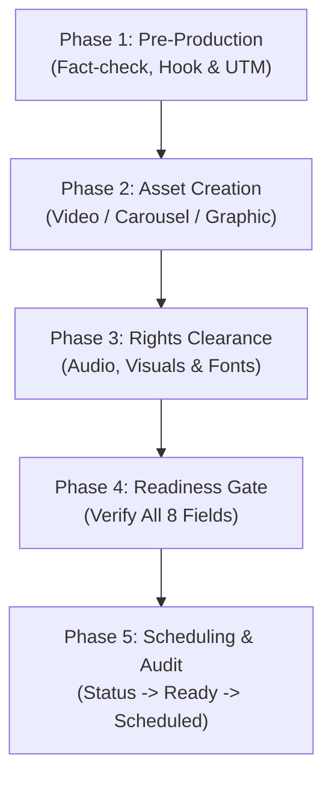

# IncuBrix Creative Production & Readiness Checklist

**Assessment Stream:** Associate Tech Partner — Growth Engineer (Option 2: Social Media Marketing & Content Engine)  
**Document:** Standard Operating Procedure (SOP) for Creative & Editable Source File Production  
**Target:** 30-Asset Content Calendar Execution  
**Status:** Operational Production SOP

---

## 1. Purpose & The Readiness Guardrail

This standard operating procedure governs the production lifecycle of each content concept outlined in `research/asset_blueprint.csv`. 

> [!IMPORTANT]
> **The Strict Readiness Rule:**  
> A concept is **never** marked `Ready` in the content calendar while it remains text-only or while any creative artifact is missing. An asset transitions from `Planned` / `Draft` to `Ready` **only** when all eight core requirements are verified:
> 1. Validated hook
> 2. Complete, platform-native caption
> 3. Normalized hashtag set
> 4. Verified Call to Action (CTA)
> 5. Active, tested UTM tracking link
> 6. Rendered final creative file (MP4, PDF, PNG) stored in repository/cloud
> 7. Preserved editable source file (Figma, PRPROJ, Canva) linked
> 8. Assigned publishing slot and date in calendar

---

## 2. Phase-by-Phase Production SOP

---

### Phase 1: Pre-Production & Verification Gate

1. **Fact-Checking & Source Grounding:**
   - [ ] Verify that every factual assertion or technical metric in the copy maps directly to an authorized source document or verified engineering standard.
   - [ ] Confirm that no claims imply hands-on testing of proprietary IncuBrix product features.
   - [ ] Confirm that no fictitious customer logos, testimonials, or revenue multipliers are included.
2. **Copywriting & Platform Adaptation:**
   - [ ] **LinkedIn:** Verify spacing, line-break readability, and professional practitioner tone. Ensure hook sits above the "see more" cutoff (first 3 lines / ~140 characters).
   - [ ] **X (Twitter):** Ensure primary post is $\le 280$ characters. For threads, ensure tweet 1 delivers standalone value.
   - [ ] **YouTube Shorts:** Ensure title is $\le 60$ characters; description includes relevant keywords and UTM link.
3. **UTM Parameter Construction:**
   - [ ] Build tracking URL using the standardized format:
     `https://incubrix.com/{path}?utm_source={platform}&utm_medium={format}&utm_campaign={campaign}&utm_content={asset_id}`
   - [ ] Validate URL encoding (no unencoded spaces or hostile formula characters).
   - [ ] Verify the destination page exists before public dispatch.

---

### Phase 2: Creative & Editable Source File Generation

#### A. Short-Form Vertical Videos ($\le 60$ Seconds)
- **Target Platforms:** YouTube Shorts, LinkedIn Video, X Video.
- **Duration Constraint:** Strictly between 30 and 58 seconds (never exceeding 60s).
- **Production Steps:**
  1. *Script & Pacing:* Structure script into Hook (0–3s), Problem/Context (3–15s), Visual Demonstration (15–45s), and Call to Action (45–58s).
  2. *Screen Recording:* Use OBS Studio at 1080x1920 (or crop 1920x1080 lossless capture). Maintain clean desktop, high-contrast dark mode editor, and 125% zoom for code legibility.
  3. *Voiceover & Audio:* Record voiceover using high-quality microphone. Normalize audio to $-14\text{ LUFS}$. If background music is used, keep at $-22\text{ dB}$ to ensure speech clarity.
  4. *Captions & Typography:* Generate dynamic, word-by-word kinetic subtitles in CapCut or Premiere Pro. Keep subtitles within safe margins (avoid bottom 20% covered by UI elements).
- **Final Creative File:** `outputs/creatives/videos/{asset_id}.mp4` (H.264 video, AAC audio, 1080x1920, 30fps).
- **Editable Source File:** `outputs/sources/videos/{asset_id}.prproj` or CapCut project archive (`.zip`) containing raw screen recordings, project timeline, and audio tracks.

#### B. Multi-Slide Carousels (PDF)
- **Target Platform:** LinkedIn (PDF Document format).
- **Slide Count:** 5 to 8 slides.
- **Production Steps:**
  1. *Slide Structure:*
     - Slide 1: High-impact hook headline + subtitle + author badge.
     - Slide 2: The Core Problem / Industry Reality.
     - Slides 3–5: Actionable, step-by-step technical framework or architecture diagrams.
     - Slide 6: Summary takeaway checklist.
     - Final Slide: Conversion CTA + follow prompt + download link.
  2. *Visual Design in Figma:* Use 1080x1350 px (4:5 portrait ratio). Ensure 80px safe margins on all sides. Use dark-mode color scheme with high-contrast accent colors (e.g. electric cyan or emerald green).
  3. *Export:* Export as individual vector pages and compile into a single optimized multi-page PDF (< 30 MB).
- **Final Creative File:** `outputs/creatives/carousels/{asset_id}.pdf`.
- **Editable Source File:** Link to Figma canvas (`.fig` file or public view/edit link in `outputs/sources/carousels/{asset_id}.fig`).

#### C. High-Resolution Graphics & Infographics
- **Target Platforms:** X (Twitter), LinkedIn.
- **Dimensions:** 1200x675 px (16:9 for X) or 1080x1080 px (1:1 for LinkedIn).
- **Production Steps:**
  1. *Diagram Clarity:* Use vector flowchart components (client, gateway, queue, database).
  2. *Text Hierarchy:* Limit text to essential labels and directional flows. Ensure labels are legible on mobile feeds.
  3. *Export:* Export lossless PNG at $2\times$ resolution for retina displays.
- **Final Creative File:** `outputs/creatives/graphics/{asset_id}.png`.
- **Editable Source File:** Layered vector Figma canvas link or `.svg` file.

#### D. Formatted Text Posts & Threads
- **Production Steps:**
  1. Draft in markdown with proper whitespace and emoji accents (max 2 per post).
  2. Run spelling and grammar review.
  3. Verify character limits.
- **Final Creative File:** Markdown copy file `outputs/creatives/copy/{asset_id}.md`.
- **Editable Source File:** Master copy draft file.

---

### Phase 3: Legal, IP & Rights Clearance Review

Before any asset is cleared for scheduling, complete the rights clearance check:
- [ ] **Commercial Audio Clearance:** Any background audio is verified as royalty-free with commercial usage rights (e.g., YouTube Audio Library, Envato, or copyright-free stem).
- [ ] **Typography Licensing:** All fonts used (e.g., Inter, Outfit, Fira Code) are licensed under SIL Open Font License (OFL) or commercial license.
- [ ] **Vector & Icon Licensing:** Icons (Lucide, Feather, FontAwesome) are open-source with MIT license.
- [ ] **Citation & Quotation Accuracy:** All quotes from whitepapers or benchmarks cite the exact author and source document.
- [ ] **AI Disclosure Stamp:** Metadata field `ai_label_needed` is explicitly set to `Yes` if generative AI assisted copy/scripting, or `No` if manually authored.
- [ ] *Action:* Update calendar column `rights_checked` to `Yes` only when all checks above are satisfied.

---

### Phase 4: Final Quality Assurance & "Ready" Transition Gate

Review the 8-point gate before changing status:

| # | Inspection Item | Verification Requirement | Pass? |
| :-: | :--- | :--- | :-: |
| 1 | **Hook Quality** | Strong, non-generic, communicates clear technical value | [ ] |
| 2 | **Caption Body** | Formatted with clean whitespace, no spelling/grammar errors | [ ] |
| 3 | **Hashtag Normalization** | 3–5 relevant, lowercased, deduplicated tags | [ ] |
| 4 | **Call to Action** | Specific conversion instruction (download, read, save) | [ ] |
| 5 | **Tracking URL** | Valid HTTPS URL with correct UTM source/medium/campaign | [ ] |
| 6 | **Final Creative File** | Rendered MP4/PDF/PNG verified and stored in outputs directory | [ ] |
| 7 | **Editable Source File** | Figma link, Canva URL, or project file preserved | [ ] |
| 8 | **Publishing Slot** | Scheduled day and time assigned in content calendar | [ ] |

**Status Transition:**  
Only when all 8 checkboxes are marked `[X]`, update `production_status` from `Planned` to `Ready`.

---

### Phase 5: Scheduling & Post-Publishing Audit

1. **Scheduling:**
   - Upload final creative file and paste approved copy and tracking link into native platform scheduling interfaces (or Buffer/Hootsuite).
   - Set status to `Scheduled`.
2. **Post-Publishing Audit (T+24 Hours):**
   - Record live publication URL in `test_published_url`.
   - Update status to `Published`.
   - Record 24-hour baseline metrics: `impressions_or_views`, `engagement_rate`, `clicks`.
